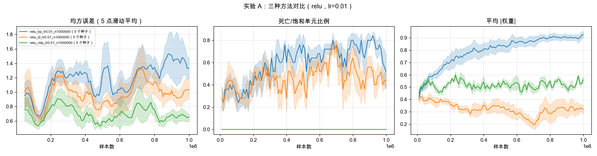

# 持续学习、可塑性与 LoRA：小规模实验室

一组可在 CPU 上阅读和复现的教学研究实验：观察网络学习新任务的能力如何变化，同时检查旧任务遗忘、低秩适配和训练动力学。保留源码、逐次运行 CSV、绘图脚本和实际生成的图表，适合学习对照实验与失败诊断。

代码开发与材料整理使用了 AI 编程工具。这是基于公开研究思想的小规模实现与探索；方法来自下列论文，不构成新的通用算法，也没有在大语言模型或真实机器人上验证。

## 内容与实际进度

公开整理日期：2026-10-30。下表按实际存在的结果文件统计，不把计划、未完成扫描或环境检查当成研究结果。

| 目录 | 研究问题 | 已保留证据与边界 |
|---|---|---|
| `01_plasticity/` | 在线缓变回归是否会失去可塑性？ | 82 份 CSV（含首轮运行、扫描与探针）；方法、学习率、激活、时长、宽度、效用和探针对照。CBP 使用贡献效用，目标阈值和初始化也做了简化，不是论文逐项复现。 |
| `02_continual_classification/` | 新任务学习与旧任务记忆能否同时保留？ | 8×8 数字的像素置换任务；主扫描实际 34/40 份 CSV，调参实际 11/48 份，均为每次 1000 个任务。EWC 扫描和公平调参未完成，不能据此给出完整方法排名。 |
| `03_td_random_walk/` | TD(λ) 如何利用下一步预测？ | 按 Sutton 1988 的五状态随机游走与 TD(λ) 更新式重新实现教学实验；保留 100 个训练集的历史结果表和图。发布检查只核对单步更新，没有重跑完整实验或对照论文数值。 |
| `04_grokking/` | 模加法何时出现延迟泛化？ | 已完成的 3 份 CSV 均为 seed=0、30000 步。wd=1.0 这次运行训练准确率在第 100 步首次达到 99%，测试在第 9400 步首次达到 95%，属于单次延迟泛化观察；不是统计显著性或跨种子稳定性证明。 |
| `05_lora_forgetting/` | LoRA 节省多少参数、遗忘多少？ | 小 MLP 的翻转和像素置换任务，保留学习率与秩扫描、ΔW 诊断。其结果不能外推成大语言模型微调结论。 |
| `06_continual_lora/` | 持续使用、合并或更换适配器会怎样？ | 32 份多配置/多种子 CSV，包含同一适配器、合并重置、全新适配器和全参数参照。合并诊断仅有 seed=0 的 150 任务历史表；权重增长、死亡单元增多与梯度变弱是同次运行的相关观察，未证明唯一因果机制，也未验证修复方案。 |

先看各目录 `results/` 中的 CSV 与汇总表，再读实现。`01_plasticity/results/sweep_figs/summary.md`、`02_continual_classification/results/figs/summary.md` 与 `06_continual_lora/results/summary.md` 中的 ± 为种子间标准误；只有一个种子的设置无法估计种子间不确定性。结果保留失败和未改善的配置。

可从 CSV 重算的汇总包括 01、02、04、05 的主结果和 06 的 300 任务主扫描。03 的 `numbers.md`、05 的 `delta_analysis.md`、06 的 `diagnose_merge.md` 是既有诊断表，未保留对应逐步 CSV；发布时未重新运行这些实验，因此它们的验证强度低于保留原始 CSV 的部分。02 中单种子配置显示的 ±0 是脚本占位，不表示估计误差为零。



## 安装与不训练的检查

需要 Python 3.10 或更新版本。创建独立环境，不依赖作者电脑上的其他项目：

```sh
python3 -m venv .venv
source .venv/bin/activate
python -m pip install -r requirements.txt
python 01_plasticity/slowly_changing_regression.py --help
python 02_continual_classification/permuted_digits.py --help
python 04_grokking/grokking_modular.py --help
python 06_continual_lora/continual_lora.py --help
```

依赖文件给出下限，未为所有系统提供锁定环境。公开整理时已检查全部 Python 源码语法、以上 CLI 入口、基础前向计算与 TD 单步更新，并重新从已有 CSV 生成汇总图表；没有重新运行训练，也没有验证 GPU。

## 数据

`01`、`03`、`04` 的输入由程序生成。`02`、`05`、`06` 使用 scikit-learn 提供的公开 `load_digits` 数据，在仓库根目录执行：

```sh
python scripts/prepare_digits.py
```

脚本将像素除以 16，生成 `data/digits_8x8.npz`（1797×64、float32，标签 int64）。原始数据文件不随仓库分发；数据来源和使用条件请查看 [scikit-learn load_digits 文档](https://scikit-learn.org/stable/modules/generated/sklearn.datasets.load_digits.html)。同一随机种子下分割训练/测试数据，测试集 360 张。小数据集结果及有限种子的结论有适用范围。

## 轻量复现入口

以下命令会进行新的 CPU 数值实验或训练。已有结果无需重跑；使用新输出目录或副本可避免覆盖同配置结果。

```sh
# 缓变回归的最小完整日志分箱：10000 个样本
python 01_plasticity/slowly_changing_regression.py --method bp --examples 10000 --no-plot --out-dir runs/smoke-bp

# 生成随机游走的图 3/4/5 和结果表
python 03_td_random_walk/sutton1988_random_walk.py

# 只重画已有 CSV，不进行训练
python 01_plasticity/summarize.py
python 02_continual_classification/summarize.py
python 04_grokking/summarize.py
python 05_lora_forgetting/summarize.py
python 06_continual_lora/summarize.py
```

`01` 以 10000 个样本分箱，`--examples` 不应小于 10000。`05_lora_forgetting/lora_vs_full.py`、`delta_analysis.py` 和 `06_continual_lora/diagnose_merge.py` 没有命令行帮助解析器，直接执行会启动实验。原有机器专用批量脚本未公开；可按主脚本参数自行组织运行。

## 方法归属

- Dohare et al., *Loss of plasticity in deep continual learning*, Nature, 2024；[官方实现](https://github.com/shibhansh/loss-of-plasticity)仅作为外部参考。本仓库使用简化 CBP 和小型替代任务。
- Sutton, *Learning to Predict by the Methods of Temporal Differences*, 1988：TD(λ) 随机游走。
- Power et al., *Grokking: Generalization Beyond Overfitting on Small Algorithmic Datasets*, 2022；Nanda et al. 与 Gromov 2023 的后续分析：模加法与表示诊断的思想来源。
- Hu et al., *LoRA: Low-Rank Adaptation of Large Language Models*：低秩参数化；Biderman et al., 2024 的遗忘研究启发了小型对照实验。
- Lialin et al., *ReLoRA*, 2023：合并和重新初始化的相关研究。本仓库的逐任务 SGD 实验不是 ReLoRA 的原样实现。
- EWC、经验回放、L2、L2-Init、Shrink & Perturb 均是已有方法；此处用于小规模学习比较。

详细范围见 [THIRD_PARTY_NOTICES.md](THIRD_PARTY_NOTICES.md)。
