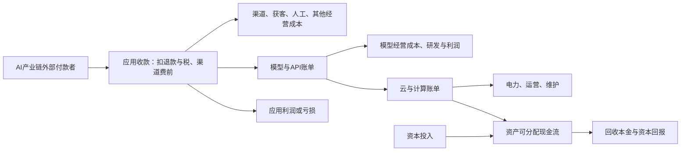

# AI 的终端需求、商业模式演化与算力回报

事实窗口：2023—2026年10月3日。条件情景：2027—2030。历史资料仅作机制对照。

## 1. 先回答三个核心问题

**已经存在真实的终端付费，但“存在付费”“经营者有可持续利润”“居民新增消费足以覆盖全部基建”是三个不同的命题。**公开资料对第一个命题已有支持，对后两个仍有很大缺口。互动陪伴、个性化歌曲和照片、语言练习，以及连接实际预约的商家接待，都比“批量制造普通内容”更接近可识别的购买理由。它们同时混合了旧支出替代、原本买不起的服务普及和新体验，不能把收入全部记作新增需求。

**生态已经发生局部变化，规模和利润的归属仍不确定。**生成成本下降让小团队提供连续服务，也让消费者参与生成作品；收费单位可以从工时或一件作品转向订阅、一次交付和一笔预约。但是渠道、用户信任、版权、反馈评估和线下履约依然构成约束。编程能力增强降低了建造应用的门槛，也增加了竞争者。报告不把代码产量当成订单，不把平台收入当成创作者利润。

**目前无法用公开证据证明消费应用足以独立承接全部算力投资，也不能据此断言没有超级应用就必然回不了本。**企业业务、广告商和商户付款、公共采购及终端设备也可形成采购或可归因收益；研发训练属于投入，其未来回款与融资来源另记。分散应用能够合计形成需求；决定回报的是实际收费、向上游传递的比例、利用率、现金成本和资产经济寿命。用户规模很大而计算账单很小，也可能对应用经营者有利，却不足以支持昂贵的新机房。

**个人最可进入的位置是一个具体付费任务的完整交付。**本轮优先验证低预算商家接待与预约、可验收商品素材、带真实数据与复核的垂直微服务。委托创作和商户数据接入保留为待验证方向。能否收费、能否续费、扣除本人劳动后是否赚钱，必须逐项验证。这不是已经验证的创业收益承诺。

以下结论均有证伪条件：若退补贴后的续费下降、真人介入持续吞掉毛利、渠道控制入口而应用失去客户关系，局部生态变化也可能无法转化为可持续利润；若多类产品持续提升实际回款且云账单与资产现金回报同步改善，则“只有工具提效”的判断需要进一步修正。

| 命题 | 本轮判断 | 能推翻或改变判断的观察 |
| --- | --- | --- |
| 单纯提效导致通缩 | 部分成立于相对价格，宏观通缩不必然 | 质量相同条件下价格未降或工资/销量/需求同步扩张 |
| 最终需要居民需求承接 | 居民福利重要，但直接订阅不是唯一外部付款 | 可归因企业节省/商户毛利/公共采购持续支付且无消费订阅 |
| 旧服务提效不能形成新市场 | 不成立为绝对命题；普及与频率可扩大实际服务 | 新增用户均替代旧渠道，品类服务量未改善 |
| AI难以创新 | 同质化有实验支持；可验证技术/服务创新有反例 | 更大任务及专业样本未复现改善，或新服务续费消退 |
| Token增长等于价值增长 | 不成立；须看收费、成功交付及完整现金成本 | 若统一任务成本/质量稳定且付费同步增长，才可作为辅助指标 |
| 没有超级应用就不能回本 | 不成立为必要条件；但分散付款能否覆盖投入未识别 | 去重外部回款在实际寿命/成本/归属下始终达不到门槛 |

## 2. 效率怎样传到价格、收入和最终需求

### 2.1 为什么提效不必然等于通缩

设原来一位老师每小时只能陪练一名学生。AI 把一次陪练的交付成本从高价人工变成低价软件后，会发生几种不同变化：原用户少花钱；原来不买服务的人开始买；原用户从每周一次变成每天练习；机构保留降本收益；部分老师转向更复杂的诊断。哪一种占主导，要查交易、工资和利润，不能仅凭“成本下降”推断。

行业名义收入是价格乘以数量。纯示例：价格从100降到40，销量从100增到200，收入从10,000降到8,000，服务量翻倍；销量增到400，收入则升到16,000。**行业收入缩水、消费者福利改善和宏观总需求不足可以同时出现，也可以不同时出现。**质量调整后的服务量与名义支出分别记录。

宏观通缩是广泛、持续的总体价格下降。某个行业降价不够证明它。生产率还会通过工资、投资、财富与利润影响需求，分配不均、就业转换和预防性储蓄又可能压低消费。Cook 2026年9月的美联储演讲将这些列为不同情景；这是机制判断，不能当作未来已发生的实证结果。[美联储原文](https://www.federalreserve.gov/newsevents/speech/cook20260928a.htm)

### 2.2 “最终居民买单”应拆成两层

作为长期经济判断，持续商业活动需要有人获得足以支付的价值，这一方向成立。但所有现金流都必须由居民当场订阅 AI，条件过强。企业可以把可归因的成本节约用于买软件；商家可以为新增订单付佣金；广告主可以购买注意力；政府可以采购公共服务；研究机构可以购买计算。这些是不同付款账户。

例如居民支付家政订单500元，商家从这500元中支付20元接待服务费，再支付上游2元API费。终端交易与中间服务不能加成522元的“AI新增消费”。若接待使原本无人接听的一笔订单成功履约，产生交易释放；若只把原先电话订单移到新界面，主要是流程替代。商户自己购买服务时，研究其软件付款；合并产业链时，剔除内部转付。

广告同理：产业链之外的广告主向娱乐平台付款是平台的外部收入；若付款者是本研究纳入的另一AI应用，属于获客中间成本，合并时应抵消。它是否带来广告主增量销售，需要另一套对照。不能把广告收入全部当作居民直接付费，也不能把广告支出与对应商品销售相加后宣称最终需求翻倍。

### 2.3 五种变化与四个观察量

本报告使用五类机制：原需求提效、旧服务替代、潜在需求释放、使用频率扩大、新服务形态。一个产品可同时属于数类。新服务指购买与交互方式发生变化，未必是全新消费类别。

四个观察量分别是付费用户数、服务次数、品类名义支出、实际服务质量。收入增长本身也不能证明付费用户或使用次数增长，可能只是涨价或结构变化；必须分别取得各自的分子和分母。家庭新增AI辅导100元、减少真人辅导500元，应用收入增加，教育支出却减少；如果孩子每天练习，实际服务次数可能增长。

判断新增需求，需要首购者以前用什么、是否削减其他支出、补贴退出后的续费，以及质量是否达标。现有案例多数缺少这套反事实数据，因此报告不输出一个“AI创造了多少居民新增消费”的伪精确总额。

### 2.4 “回归平均值”与创新不是同一个检验

普通生成任务可能更同质化。Doshi与Hauser的短故事随机实验观察到个人评价改善，同时不同作品之间更相似；样本是短篇实验，不能直接推导专业创作的上限或商业票房。[原始论文](https://doi.org/10.1126/sciadv.adn5290)

但创新也可以由生成、可执行验证、筛选和迭代组成。AlphaEvolve的算法案例说明，在有明确评价标准的环境里，模型可参与改进真实计算流程。这是技术流程的反例，部署与算力节省来自公司自报，未披露该改进的独立商业利润，不能据此证明文化创新或居民愿意付费。[DeepMind原始说明](https://deepmind.google/blog/alphaevolve-a-gemini-powered-coding-agent-for-designing-advanced-algorithms/)

对经济应用来说，创新不要求每个模型输出都偏离平均值。把低成本、随时可用、可交互的能力组合成过去买不起的服务，也可能改变交易。反过来，生成更多作品若仍依赖相同渠道和稀缺注意力，容易先扩大供给拥挤。应查最终成功交付和愿意付钱的客户，而不是只查生成量。

### 2.5 移动互联网对照：旧需求也能形成新的交易组织

Uber没有发明出行欲望，它改善了找车、匹配、付款和信任。四个美国城市的2015年研究估计了消费者剩余，但消费者剩余不等于新增消费或公司利润。公司到2023年才首次实现全年GAAP经营利润。用户价值、交易规模和平台经营盈利出现于不同时间；经营盈利仍不等于投资人已回收累计投入。[NBER原始研究](https://www.nber.org/papers/w22627)、[Uber原始历史披露](https://www.sec.gov/Archives/edgar/data/1543151/000155278124000177/e24048_uber-def14a.htm)

到2025年Uber总预订额1,934.54亿美元、确认收入520.17亿美元、经营利润55.65亿美元。这些口径分别对应交易、平台收入和利润，不能相加。它说明重组旧服务也能建立庞大产业，但不说明AI可以复制相同规模或盈利时间。[Uber 2025业绩](https://investor.uber.com/news-events/news/press-release-details/2026/Uber-Announces-Results-for-Fourth-Quarter-and-Full-Year-2025/default.aspx)

外卖平台同样把旧需求变得方便，并把商户、配送和消费者连接起来；毛利仍受履约、促销、广告及获客影响。DoorDash的2023—2025财务轨迹说明，交易和用户频率增长与利润改善应分别测量。[DoorDash原始财报](https://ir.doordash.com/news/news-details/2026/DoorDash-Releases-Fourth-Quarter-and-Full-Year-2025-Financial-Results/default.aspx) 中国商家案例则显示，平台可以免费提供AI经营工具以加强已有订单生态；这并不意味着独立工具商有同等的收费空间。

数字内容的约束有所不同。内容制作更便宜不会等比例增加观众的时间，平台分发和头部注意力仍稀缺。因此“让普通人能参与一次创作”与“让大量创作者靠批量发行赚钱”必须分开。前者的客户直接购买体验或交付；后者还要面对点击、分成、投流和作品之间的竞争。

### 2.6 已有对照实验给出的限制

一项2026年发表的原始实地随机实验，让640名肯尼亚小企业主在2023年使用GPT-4商业助手约五个月。研究未能拒绝“平均收入和利润效果为零”的假设，且效果因原有经营水平而异。这不是证明AI平均效果恰好为零，也不能直接校准2026年的中美门店；它提醒我们，获得建议和更多内容并不保证转成客户与利润。样本收入和利润主要来自自报，报告据此要求商家案例同时记录实际履约、收款、对照和完整成本。[原始论文](https://escholarship.org/content/qt0fb001r8/qt0fb001r8.pdf)

## 3. 中美八类场景与商业模式变化

本轮按公开证据建立32个正反位置，深挖12个案例，中美锚点各六个。**国别是公司/产品或具名本地经营者的研究锚点，收入地理归属另列。**Speak、CHAI、Suno的数字多为全球；星野/Talkie为国内与海外组合；美图生产力为全球多产品组合。美国个人创业深例使用佛州Formula Bot，荷兰创始人的PhotoAI另作跨境补充。因此可以比较路径，不能据这组样本计算中美居民钱包规模或成功率。

在可观察的中国样本中，既有教育/影像品牌和交易平台是重要入口，付费与免费嵌入并存；在美国样本中，自费订阅、独立微服务和本地商家的软件采购有具名例子。这是样本结构与机制观察，不是“中国只有平台、美国只有创业者”的产业普查。

| 场景 | 中国样本/缺口 | 美国样本/缺口 | 变化与付款边界 |
| --- | --- | --- | --- |
| 学习、语言与技能 | 有道AI组合有销售；Hi Echo单品缺收入/续费 | Speak有订阅与练习；居民与企业未拆 | 低价、随时陪练可能释放需求；效果与总教育支出未证 |
| 陪伴与角色互动 | 星野/Talkie合并有订阅、内购及广告 | CHAI消费者订阅/IAP；Replika服务变化对照 | 内容变成参与互动；连续收入不等于同用户续费 |
| 个人创作与表达 | Mureka中文入口与合同；可靠付款规模空缺 | Suno付费订阅；PhotoAI全球补充 | 用户为表达或交付买单，作品下游赚钱另算 |
| 漫剧、视频与游戏 | DataEye抖音播放代理；项目账本缺 | AI Dungeon收费目录；Sora web/app停服 | 制作便宜，分发、注意力与版权仍约束利润；独立游戏损益缺 |
| 独立开发与微服务 | 企业小工作室及关停；草根完整损益缺 | Formula Bot收费、停滞与转型 | 小团队能交付完整工作流；单次调用易被通用模型追平 |
| 小商家线上经营 | 设计室工具商确认收入；小应仅宣传自述 | AI转介订单有增长；小店净贡献缺 | 产图→验收上架可能提效；工具利润与商品利润分开 |
| 线下服务与履约 | 美团免费经营工具仅餐饮；维修家政美业缺 | Goodcall清运商短期自报且同期Yelp | 接待→留资→预约→履约→收款，不能只数电话 |
| 平台、购物与中介 | Qwen淘宝目录接入；实付净GMV/复购缺 | ChatGPT结账转向并保留商品发现 | 入口变动不自动重建支付、库存、信任与售后 |

## 4. 成功、收缩与未兑现证据的经济账

“supported”表示某项付款、使用或流程证据成立，**不表示公司或客户已经净盈利**；“limited”表示研究结论受限，不判失败。DataEye负面是播放门槛代理，不是实际损益。下文逐案区分付款、成本、复购、利润与计算归属；未知留空，不用母公司财报或融资补齐。

12个深例及补充资料中，四项可定位的收缩/不利阶段是：ChatGPT初版统一结账回撤；美图若干商业牵引不足工作室关闭；Formula Bot免费成本冲击与增长停滞；Sora web/app实际停服。另保留Replika付费体验变更及漫剧播放代理。关停、产品调整、增长停滞与亏损各有不同含义，缺分母，不能外推失败率。

### 1. 有道 Hi Echo 与AI订阅组合：口语陪练

**锚点与地理边界：**中国锚点。产品市场：Hi Echo国内中文产品；AI订阅组合同时包含海外工具；经营主体：北京网易有道计算机系统有限公司；Youdao / NetEase集团；用户地理范围：Hi Echo主要国内使用，组合销售不能限定为国内居民

**过去与现在：**从查词、跟读或预约真人练口语，变为和AI虚拟英语教师随时对话；AI同时进入有道既有词典、翻译和硬件渠道。这是旧产品渠道扩展与新的练习服务并存。

**谁付款、买什么：**Hi Echo年卡面向个人购买，可由家长付款；有道AI订阅组合还包含翻译、转录、论文写作等产品及海外用户。 Hi Echo年卡与其他AI功能订阅；部分功能嵌入词典笔等硬件。组合销量并不等于Hi Echo独立收入。

**需求变化分类：**原需求提效／旧服务替代／使用频率扩大。这是机制解释，不是已测得的新增支出比例。

**可识别成本与利润：**独立推理、语音、渠道、获客成本未拆分。历史佣金规则显示有分销成本，但没有成交规模及总获客成本。 需要核对语音/推理、内容、渠道、获客与人工支持。有道集团2025年经营利润为正，但不能据此宣称Hi Echo或AI订阅组合盈利。

**再次购买与计算：**推广佣金要求购买后7天内使用、60天内未退款；这是结算规则，不能推断真实使用、退款或年卡续费率。 对话与实时反馈产生持续推理；硬件捆绑、跨产品订阅使软件收入与算力成本归属更难核对，缺少单次口语练习成本。

**流程与利润归属：**中国既有教育/翻译品牌以原有渠道售卖AI增值订阅，终端入口可能先落在熟悉的词典、笔和年卡。该证据证明组合商业化，尚不能确认独立口语陪练的大规模复购。

**反证与替代解释：**同一集团AI订阅销售增长而智能设备收入下降，说明AI功能与用户需求不是一条共同上升曲线。应对照非AI会员、设备原有功能以及免费陪练，拆出AI功能增量付款；硬件下降仅作为相关业务需求弱化，不作为Hi Echo失败判决。

**主要缺口：**Hi Echo单独的收入、付费人数及退款率；AI订阅组合的国内居民、海外居民、专业用途拆分；纯软件与硬件捆绑价值拆分；学习效果和年卡续订的独立证据；产品级利润与推理成本。

来源：[Youdao Maintains Profitability for Five Consecutive Quarters...](https://www.prnewswire.com/news-releases/youdao-maintains-profitability-for-five-consecutive-quarters-operating-profit-for-the-first-three-quarters-of-2025-grows-nearly-150-year-over-year-302621424.html)、[NetEase 2025 Annual Report / Form 20-F](https://www1.hkexnews.hk/listedco/listconews/sehk/2026/0415/2026041501212.pdf)、[网易有道Hi Echo推广活动规则及个人信息授权](https://c.youdao.com/dict/law/HiEcho_promotion%26authentication.html)、[Youdao Reports Fourth Quarter and Fiscal Year 2025 Unaudited Financial Results](https://en.prnasia.com/releases/global/youdao-reports-fourth-quarter-and-fiscal-year-2025-unaudited-financial-results-522161.shtml)。

| 指标 | 数值与单位 | 期间 | 证据性质 | 口径与限制 | 出处 |
| --- | --- | --- | --- | --- | --- |
| AI订阅组合销售额 | 100,000,000 RMB，接近 | 2025Q3 | 已核对公司披露 | 公司称nearly RMB100 million，增长超过40%；是多个AI订阅产品的sales，未给Hi Echo分项，也不等同会计确认收入或中国居民纯学习支出。 | [Youdao Maintains Profitability for Five Consecutive Quarters...](https://www.prnewswire.com/news-releases/youdao-maintains-profitability-for-five-consecutive-quarters-operating-profit-for-the-first-three-quarters-of-2025-grows-nearly-150-year-over-year-302621424.html) |
| Hi Echo独立居民付费人数 | 未披露 | 截至2026-10-03的公开检索 | 未披露 | 收费规则存在，但未取得可核对的独立购买人数。 |  |
| Hi Echo独立收入 | 未披露 | 截至2026-10-03的公开检索 | 未披露 | 组合销售不能替代该项。 |  |
| 历史推广活动税后佣金第一档 | 10 %成交金额 | 活动截至2025-12-31，起始日期未披露 | 收费或合同规则 | 仅对活动中累计成交50000元以内部分；不是实际CAC、分销商收入或已实现成交。 | [网易有道Hi Echo推广活动规则及个人信息授权](https://c.youdao.com/dict/law/HiEcho_promotion%26authentication.html) |
| 有道智能设备收入 | 739,600,000 RMB | 2025年 | 已核对公司披露 | 全年同比下降18.2%，公司归因需求下降；是整个智能设备业务，不能归因Hi Echo，也不是AI订阅亏损。 | [Youdao Reports Fourth Quarter and Fiscal Year 2025 Unaudited Financial Results](https://en.prnasia.com/releases/global/youdao-reports-fourth-quarter-and-fiscal-year-2025-unaudited-financial-results-522161.shtml) |

### 2. Speak：AI口语陪练

**锚点与地理边界：**美国锚点。产品市场：早期韩国；2025年扩张美国；全球多语言市场；经营主体：Speakeasy Labs，美国企业；用户地理范围：数字为全球或未拆；不可作美国居民总量

**过去与现在：**过去以课程、录音跟读或约真人陪练获得口语练习；产品现在提供可自定义场景的连续对话、即时反馈和个性化课。改变的是获得练习对象的频率及门槛，学习成效的增量尚不能由使用量直接证明。

**谁付款、买什么：**主要为自费语言学习者；也有企业为员工购买，最新收入无法拆出居民自付部分。 个人订阅；企业订阅并存。居民购买的是反复开口、纠错和情境练习的服务。

**需求变化分类：**潜在需求释放／使用频率扩大／旧服务替代。这是机制解释，不是已测得的新增支出比例。

**可识别成本与利润：**没有足够公开资料把推理、语音、渠道、获客和课程成本分拆；不能由订阅价推断毛利。 需要核对语音/推理、内容、渠道、获客与人工支持。未取得产品级或公司完整净利润披露。

**再次购买与计算：**年度练习增长是使用证据，缺少付费用户续订率、同一 cohort 的D30/D90及重复付款。 每次语音识别、生成反馈和开放对话会触发推理；缺少每分钟/每个付费用户成本与用量，不能从练习小时换算token或基建回报。

**流程与利润归属：**从语音识别与既定课程，演化到可随时调出、围绕个人错误和场景反复练习的AI陪练。商业化体现为练习服务订阅，尚未证明通用教育被重构。

**反证与替代解释：**早期已有近10万付费用户，且当时开放式生成AI Tutor仍在开发；因此不能把全部现有收入归因为LLM。应对照旧版语音课程、真人陪练和免费通用模型，核查新增付费、续费及口语考试/真实交流结果。

**主要缺口：**最新居民自费收入与企业收入拆分；本国消费者收入拆分；免费转付费、续费、退款与 cohort 留存；对真实口语能力的独立对照验证；推理费用、渠道抽成、CAC与利润。

来源：[Speak Announces $27M Series B Led by OpenAI Startup Fund](https://www.speak.com/blog/speak-announces-27m-series-b-led-by-openai-startup-fund)、[Speak: KI-App setzt auf Sprechen statt Grammatik](https://www.forbes.at/artikel/speak-ki-app-setzt-auf-sprechen-statt-grammatik)、[A year in conversation | Speak Wrapped 2025](https://www.speak.com/blog/speak-wrapped-2025)。

| 指标 | 数值与单位 | 期间 | 证据性质 | 口径与限制 | 出处 |
| --- | --- | --- | --- | --- | --- |
| 历史付费订阅者 | 100,000 人，近似且略低于 | 截至2022-11-18 | 已核对公司披露 | 公司称nearly 100,000；主要市场当时为韩国。这证明此前AI语音学习付费存在，不能单独证明后来生成式AI Tutor带来的新增付费。 | [Speak Announces $27M Series B Led by OpenAI Startup Fund](https://www.speak.com/blog/speak-announces-27m-series-b-led-by-openai-startup-fund) |
| 公司年度化收入规模 | 100,000,000 USD/年，约 | 2025-11-12报道时点 | 原始采访公司自述 | Forbes创始人采访的授权德文版本写约1亿美元年度收入；未给完整会计期间和经审计报表，本研究保守列作公司年度化收入规模。主要来自订阅但包含500家企业服务；不是居民实收、不代表美国收入。 | [Speak: KI-App setzt auf Sprechen statt Grammatik](https://www.forbes.at/artikel/speak-ki-app-setzt-auf-sprechen-statt-grammatik) |
| 全平台练习时长 | 19,600,000 小时 | 2025年 | 已核对公司披露 | 同比增长85%；公司汇总全球全平台，付费/免费/企业未分，不能视为留存率或学习效果。 | [A year in conversation ／ Speak Wrapped 2025](https://www.speak.com/blog/speak-wrapped-2025) |
| 全平台个性化课程数 | 80,300,000 课次 | 2025年 | 已核对公司披露 | 同比增长154%；是启动/创建行为，非独立用户数或付费人数。 | [A year in conversation ／ Speak Wrapped 2025](https://www.speak.com/blog/speak-wrapped-2025) |
| 当前居民付费订阅人数 | 未披露 | 截至2026-10-03的公开检索 | 未披露 | 未获得可核对的最新、按居民自付及地理拆分人数。 |  |

### 3. 星野 / Talkie：角色互动的全球合并经济账

**锚点与地理边界：**中国锚点。产品市场：星野为中国国内市场；Talkie国际市场；经营主体：MiniMax集团，财务披露合并两产品；用户地理范围：跨境组合；国内星野付款未单列

**过去与现在：**从消费固定故事或真人社交，变成自己设定人物、声音和性格，在持续生成的对话里参与情节；会员购买更好的记忆、更多互动和响应体验。

**谁付款、买什么：**居民买月度会员和应用内虚拟商品；免费Talkie用户的广告收入由广告主付款。星野为中国产品、Talkie面向国际市场，财报把两者合并。 订阅＋应用内购买＋广告。三种现金来源必须分开；广告不是居民钱包直接付款。

**需求变化分类：**新服务形态／使用频率扩大。这是机制解释，不是已测得的新增支出比例。

**可识别成本与利润：**公司区分推理相关销售成本和训练研发，但此产品组合的成本未单列；所有AI-native产品毛利率不是陪伴产品毛利率。 需要核对推理/记忆、训练研发、渠道、获客与内容运营。没有产品级盈利披露。集团、所有AI-native产品以及Talkie/星野为不同口径，不互相代填。

**再次购买与计算：**付费期间去重人数不是留存；没有获得星野单独的续费、cohort留存或退款率。 连续对话和记忆为推理需求；免费广告、居民会员与共享模型共存，使token增长不等于付费增长。缺少产品单位推理成本与训练资本回收的对应关系。

**流程与利润归属：**由一次性内容消费变为角色创建、关系延续和互动平台；全球组合直接付费合计扩大，但国内份额、同人消费与居民总娱乐新增支出未证。广告占多数及客均下降需要与总付费增长同时呈现。

**反证与替代解释：**全球组合2025年前九个月订阅＋IAP合计7.562百万美元，2024同期间3.629百万美元，约增长108.4%；同期期间付费用户约139万，上一年约49万，但期间人均付费由7美元降为5美元。总直接付费和用户规模扩张与客均下降可以同时发生；不代表直接付费市场收缩。需同人cohort、地区拆分和居民娱乐总预算，才能判定国内需求及净新增消费；不能解读为星野亏损。

**主要缺口：**星野与Talkie独立收入、付费人数和地区分布；中国消费者自付收入；订阅与IAP用户重叠及支付频次；绝对cohort留存、续订与退款；独立产品毛利、获客成本和利润。

来源：[MiniMax Global Offering Prospectus](https://www1.hkexnews.hk/listedco/listconews/sehk/2025/1231/2025123100025.pdf)、[MiniMax 2025 Annual Report](https://www1.hkexnews.hk/listedco/listconews/sehk/2026/0422/2026042202118.pdf)。

| 指标 | 数值与单位 | 期间 | 证据性质 | 口径与限制 | 出处 |
| --- | --- | --- | --- | --- | --- |
| Talkie/星野合并总收入 | 18,750,000 USD | 2025-01-01至2025-09-30 | 已核对公司披露 | 合并国际Talkie和国内星野；其中包含广告，不能叫中国居民AI陪伴支出。 | [MiniMax Global Offering Prospectus](https://www1.hkexnews.hk/listedco/listconews/sehk/2025/1231/2025123100025.pdf) |
| Talkie/星野合并订阅收入 | 6,604,000 USD | 2025-01-01至2025-09-30 | 已核对公司披露 | 地区未拆分；订阅确认收入，不是年卡现金或ARR。 | [MiniMax Global Offering Prospectus](https://www1.hkexnews.hk/listedco/listconews/sehk/2025/1231/2025123100025.pdf) |
| Talkie/星野合并IAP收入 | 958,000 USD | 2025-01-01至2025-09-30 | 已核对公司披露 | 地区未拆分。 | [MiniMax Global Offering Prospectus](https://www1.hkexnews.hk/listedco/listconews/sehk/2025/1231/2025123100025.pdf) |
| Talkie/星野合并消费者订阅加充值确认收入 | 7,562,000 USD | 2025-01-01至2025-09-30 | 按披露派生 | 6.604m订阅＋0.958mIAP；仅全球合并产品，不是中国份额。 | [MiniMax Global Offering Prospectus](https://www1.hkexnews.hk/listedco/listconews/sehk/2025/1231/2025123100025.pdf) |
| Talkie/星野合并消费者订阅加充值确认收入，比较期 | 3,629,000 USD | 2024-01-01至2024-09-30 | 按披露派生 | 2.917m订阅＋0.712mIAP；全球两产品合并，地区及同人消费未拆。 | [MiniMax Global Offering Prospectus](https://www1.hkexnews.hk/listedco/listconews/sehk/2025/1231/2025123100025.pdf) |
| Talkie/星野合并消费者订阅加充值确认收入同比增长 | 108.4 %，约 | 2025前九个月 vs 2024前九个月 | 按披露派生 | (7.562m/3.629m−1)×100≈108.4%；是同产品组合确认收入合计增长，不是中国星野份额、同一批用户钱包增长或居民总娱乐新增支出。 | [MiniMax Global Offering Prospectus](https://www1.hkexnews.hk/listedco/listconews/sehk/2025/1231/2025123100025.pdf) |
| Talkie/星野合并广告收入 | 11,188,000 USD | 2025-01-01至2025-09-30 | 已核对公司披露 | 约占合并总收入59.7%；广告主付款，不能和居民直接订阅等价。 | [MiniMax Global Offering Prospectus](https://www1.hkexnews.hk/listedco/listconews/sehk/2025/1231/2025123100025.pdf) |
| Talkie/星野期间付费用户 | 1,390,400 人 | 2025-01-01至2025-09-30 | 已核对公司披露 | 定义为期间至少发生一次货币交易；不是月付订阅用户，不能和平均MAU直接相除得到付费率。 | [MiniMax Global Offering Prospectus](https://www1.hkexnews.hk/listedco/listconews/sehk/2025/1231/2025123100025.pdf) |
| Talkie/星野期间人均付费 | 5 USD/期间付费用户，取整 | 2025-01-01至2025-09-30 | 已核对公司披露 | 同口径2024年前九个月为7美元；期间付费人数增长包含低消费用户。不是月ARPPU。 | [MiniMax Global Offering Prospectus](https://www1.hkexnews.hk/listedco/listconews/sehk/2025/1231/2025123100025.pdf) |
| 星野单独中国消费者订阅加充值确认收入 | 未披露 | 截至2026-10-03的公开检索 | 未披露 | 2025年报仍仅给更大产品类别与集团地区拆分，不能用中国集团收入填补。 | [MiniMax 2025 Annual Report](https://www1.hkexnews.hk/listedco/listconews/sehk/2026/0422/2026042202118.pdf) |

### 4. CHAI：AI角色互动；Replika作为连续性反例

**锚点与地理边界：**美国锚点。产品市场：全球移动应用市场；经营主体：Chai Research Corp.，Palo Alto，美国；用户地理范围：收入及用户未按国家拆分

**过去与现在：**从看作者编写的固定故事、和真人互动，变为可由本人设定人物并持续参与情节的AI角色对话；用户既是参与者，也可以成为角色作者。

**谁付款、买什么：**CHAI消费者直接支付订阅和应用内购买。披露无按国家的付款拆分。 消费者订阅与应用内购买。用户购买互动体验、角色和对话服务，不以出售生成内容为必要条件。

**需求变化分类：**新服务形态／使用频率扩大。这是机制解释，不是已测得的新增支出比例。

**可识别成本与利润：**公司自建模型及推理基础设施，披露模型路由和优化；未提供可审计的推理单位成本、渠道抽成、CAC及销售营销额。 需要核对推理/记忆、训练研发、渠道、获客与内容运营。截至2026-10-01，公司自称unit economics盈利，且剔除销售营销后盈利；完整利润未知，不能把部分成本前口径写成净利润。

**再次购买与计算：**2024年公司作者论文在平台30天A/B实验比较模型组合的互动/留存表现；不是2026实际付费续订、绝对D30留存或独立复制。 官方把对话模型训练、推理、GPU运维与消费App放在同一主体；可证明此类互动需要持续计算，不能据自报token总量换算付费需求或基建盈利。模型组合论文说明消费效果可能由较小模型获得。

**流程与利润归属：**商业模式从卖完成的内容扩展为卖可持续参与的角色关系和互动。这里AI本身构成服务内容，付费无需依靠用户先用AI赚钱。

**反证与替代解释：**Replika在2023年改变付费互动服务后，ABC采访的用户描述人格与关系体验骤变，并出现转移平台的行动；其中一位受访者位于得州。这是有原始用户证据的服务连续性失败，未披露总体取消率或亏损。陪伴需求依赖记忆、人格、规则稳定性，模型更新可能破坏已付费的体验。

**主要缺口：**付费人数、按国家收入及付费渗透；D30/D90绝对留存与月/年续费；完整净利润、销售营销费、CAC及推理单位成本；Replika反例不能推广成全行业流失比例；长期互动效益及可能挤出其他娱乐支出的独立研究。

来源：[CHAI: Company Facts and Working Here](https://www.chai-research.com/company-facts/)、[Blending Is All You Need: Cheaper, Better Alternative to Trillion-Parameters LLM](https://arxiv.org/abs/2401.02994)、[Replika users fell in love with their AI chatbot companions. Then they lost them](https://www.abc.net.au/news/science/2023-03-01/replika-users-fell-in-love-with-their-ai-chatbot-companion/102028196)。

| 指标 | 数值与单位 | 期间 | 证据性质 | 口径与限制 | 出处 |
| --- | --- | --- | --- | --- | --- |
| 公司年度化收入run rate | 120,000,000 USD/年 | 截至2026-10-01 | 已核对公司披露 | 官方明确当前收入外推全年，不是一个会计期间确认收入；全为公司自报、未经审计。业务写明消费者订阅和IAP，未给美国居民份额。 | [CHAI: Company Facts and Working Here](https://www.chai-research.com/company-facts/) |
| 居民实际付费人数 | 未披露 | 截至2026-10-03的公开检索 | 未披露 | 日活和过去一年登录人数不作为付费人数。 |  |
| 公司完整净利润 | 未披露 | 截至2026-10-01 | 未披露 | 公司仅称单位经济盈利、剔除销售营销支出后盈利，不能当作完整公司盈利。 | [CHAI: Company Facts and Working Here](https://www.chai-research.com/company-facts/) |

### 5. 昆仑万维 Mureka：个人音乐创作与消费平台

**锚点与地理边界：**中国锚点。产品市场：Mureka.cn国内中文入口；Mureka.ai全球产品；经营主体：昆仑万维集团业务；Mureka.ai合同写新加坡办公室运营；用户地理范围：国内、海外、居民、专业及API收入未拆

**过去与现在：**过去依赖乐器、制作软件和专业技能完成音乐想法；现在使用自然语言和参考曲生成并修改歌曲。产品同时发展制作套件、分享消费入口和开发者API。

**谁付款、买什么：**国内中文站有Pro/Premier会员入口；全球服务含个人与专业创作者。已取得收费合同与产品证据，但未取得可信的独立居民付款规模。 免费入口＋月/年订阅及credits；订阅功能覆盖高级生成、编辑、分轨、导出与商业使用条款。具体套餐标价不能替代成交。

**需求变化分类：**参与式新服务候选；实际规模待证。这是机制解释，不是已测得的新增支出比例。

**可识别成本与利润：**母公司自研音乐模型，产品有音频生成和分轨等计算；独立训练、推理、渠道和获客费用未披露。 需要核对生成重试、编辑、版权、渠道、获客与人工支持。未获得独立利润，不能把集团盈亏或其他AI业务的流水归给Mureka。

**再次购买与计算：**全球服务合同有月/年自动续订条款，但没有实际续费率、cohort留存或退款数字；自动续订条款不是复购证明。 生成、重混、分轨、音视频功能与开发者API产生计算需求；订阅消费者、专业创作者、API的收入及算力未分，不能据能力升级判断需求兑现。

**流程与利润归属：**产品正在从生成器转向参与创作、专业编辑和分享消费平台；终端形态比单纯生成更多歌曲更丰富。当前公开证据主要是产品和商业结构，仍不足以证明国内居民长期复购与盈利。

**反证与替代解释：**功能与年卡合同能够存在，而独立付费人数、收入和续费仍不可观察。应对照免费创作用户、传统音乐App会员和专业工具付款，索取真实付款及重复使用；未披露不等于亏损或没有人购买。

**主要缺口：**独立付费人数和确认收入；国内居民、海外消费者、专业工作及API的拆分；创作兴趣型使用是否重复、续费与退款；普通创作者获得的收入或商业订单；产品完整成本与利润。

来源：[Mureka中国站会员页面](https://www.mureka.cn/subscribe)、[Mureka Terms of Service](https://www.mureka.ai/static/terms-20260513.pdf)、[昆仑万维2025年度总经理工作报告](https://disc.static.szse.cn/disc/disk03/finalpage/2026-04-24/6719a18a-7d91-44b2-aa54-041ae28ac3b3.PDF)。

| 指标 | 数值与单位 | 期间 | 证据性质 | 口径与限制 | 出处 |
| --- | --- | --- | --- | --- | --- |
| Mureka独立付费人数 | 未披露 | 截至2026-10-03的公开检索 | 未披露 | 未找到可核对的公司原始披露；不采纳未有原始出处的第三方‘20万付费’等数字。 |  |
| Mureka独立确认收入 | 未披露 | 截至2026-10-03的公开检索 | 未披露 | 昆仑万维集团收入、短剧平台ARR以及多个AI业务流水不可替代Mureka。 |  |
| 中国居民个人娱乐用途收入 | 未披露 | 截至2026-10-03的公开检索 | 未披露 | 国内中文会员入口证明可售服务存在，全球服务及API不能推成国内钱包规模。 |  |

### 6. Suno：个人参与音乐创作

**锚点与地理边界：**美国锚点。产品市场：全球音乐创作市场；经营主体：Suno，美国企业；用户地理范围：全球、专业及业余未拆

**过去与现在：**过去未掌握作曲、演唱、编曲工具的人往往只听歌或写想法；现在可用文本生成、重混并分享个人歌曲。专业使用则进一步编辑分轨、样本和制作流程。

**谁付款、买什么：**业余创作者、音乐爱好者和专业制作人购买订阅及额外下载。官方付费数字不按身份和国家拆分。 分层订阅＋额外下载付费；个人娱乐表达与商业制作混合。服务的居民最终需求可以是参与创作本身，而不要求作品在流媒体上赚钱。

**需求变化分类：**潜在需求释放／参与式新服务／专业制作提效。这是机制解释，不是已测得的新增支出比例。

**可识别成本与利润：**未获得单位生成/推理、渠道、获客与授权相关支出分拆；融资金额与估值不填作营业收入或盈利证据。 需要核对生成重试、编辑、版权、渠道、获客与人工支持。未获得公司完整净利润或个人娱乐产品利润披露。

**再次购买与计算：**公开付费订阅总量不能给出同期付费留存；没有可核对的D30/D90、月续订、年续订与退款。 生成、重混及音频编辑直接产生计算需求，但每首成本、使用强度、权益与成本关系未知；不能由歌曲数推算token，也不能由run rate推算所有算力投资回收。

**流程与利润归属：**可能的新终端是参与式创作娱乐：用户为表达和玩音乐付费。它与大量生成目录后等待流媒体分成的生产者商业模式不同，需要分别核查。

**反证与替代解释：**2026年9月起平台限制多数套餐的下载，官方目的包括降低批量导出；平台内创建、听、分享仍可继续。把付费创作服务等同于消费者能靠批量曲目赚钱不成立；没有足够资料判断这一政策后的退款、流失或作品收益。

**主要缺口：**业余娱乐、专业创作及企业使用的收入拆分；居民地理归属；付费留存、政策变更后的取消/退款；普通用户的作品出售收入与净收益；完整成本、利润和版权支出。

来源：[Suno Careers — How big is Suno?](https://about.suno.com/careers)、[The Next Chapter for Suno](https://blog.suno.com/blog/series-d-announcement)、[An update to our downloads policy and Terms of Service](https://suno.com/blog/suno-updates-tos)。

| 指标 | 数值与单位 | 期间 | 证据性质 | 口径与限制 | 出处 |
| --- | --- | --- | --- | --- | --- |
| 付费订阅者下限 | 2,000,000 人，超过 | 2026年初 | 已核对公司披露 | 官方招聘页面自报2+ million，未经独立审计；全球、业余/专业、个体/组织未拆分，不是美国居民人数。 | [Suno Careers — How big is Suno?](https://about.suno.com/careers) |
| 公司年度收入run rate | 300,000,000 USD/年 | 页面于2026-10-03读取；指标具体时点未标 | 已核对公司披露 | 年化run rate不是全年实收或确认收入；页面同段落包含2026年初人数和2026年6月融资，无法把每项统一到同一天。 | [Suno Careers — How big is Suno?](https://about.suno.com/careers) |
| Pro下载配额 | 20 次/月 | 2026-09-03起，2026-08-10公告 | 收费或合同规则 | 配额不是实际下载量或付费需求；Premier为60次/月，Premier Studio不设此限制。 | [An update to our downloads policy and Terms of Service](https://suno.com/blog/suno-updates-tos) |
| 居民个人娱乐用途收入 | 未披露 | 截至2026-10-03的公开检索 | 未披露 | 专业工作与业余个人消费未分。 |  |

### 7. DataEye抖音AI剧漫剧：供给扩张与播放门槛

**锚点与地理边界：**中国锚点。说明：锚点不等于消费者所在地；见付款方与指标口径。

**过去与现在：**产量扩张；大多数单端新剧未过统一播放门槛，真实亏损率未核验。

**谁付款、买什么：**广告主、平台及部分付费观众；样本付款方比例未知 广告分成、承制/版权、付费发行等；报告未给项目分成

**需求变化分类：**原需求提效／供给扩张；新增品类支出未证。这是机制解释，不是已测得的新增支出比例。

**可识别成本与利润：**未取得项目账本；统一播放线不能适配不同成本。 需要核对IP、制作、抽卡重试、投流、分成、人工与退款。negative为门槛代理负面，实际利润未知。

**再次购买与计算：**无观众/创作者留存队列。 播放不可换成Token/GPU小时；重试造成成本但账单缺失。

**流程与利润归属：**供给扩大与头部竞争可同时出现；未证居民新增娱乐预算。

**反证与替代解释：**比较同题材真人/非AI剧的净分成、居民总娱乐消费；流量份额迁移非增量。

**主要缺口：**项目原表与门槛依据；版权/制作/投流/推理成本；多端净回款；居民与广告付费拆分。

来源：[DataEye2026上半年AI剧漫剧报告精简版](https://www.thepaper.cn/newsDetail_forward_33665132)。

| 指标 | 数值与单位 | 期间 | 证据性质 | 口径与限制 | 出处 |
| --- | --- | --- | --- | --- | --- |
| 抖音端新剧数量 | 221,900 部 | 2026H1 | 第三方播放代理 | 22.19万为公开约数；非全渠道去重作品。 | [DataEye2026上半年AI剧漫剧报告精简版](https://www.thepaper.cn/newsDetail_forward_33665132) |
| 超过5000万播放门槛新剧 | 2,886 部 | 2026H1 | 第三方播放代理 | 统一假定盈亏基线，无逐剧成本/多端收入。 | [DataEye2026上半年AI剧漫剧报告精简版](https://www.thepaper.cn/newsDetail_forward_33665132) |
| 跨门槛比例 | 1.3 % | 2026H1 | 第三方播放代理 | 原文明确非全行业；多端盈利比例高于此比例。 | [DataEye2026上半年AI剧漫剧报告精简版](https://www.thepaper.cn/newsDetail_forward_33665132) |
| 未跨门槛比例 | 98.7 % | 2026H1 | 按披露派生 | 100%-1.3%，不能写红果/全行业实际亏损率。 | [DataEye2026上半年AI剧漫剧报告精简版](https://www.thepaper.cn/newsDetail_forward_33665132) |

### 8. Formula Bot：佛州个人创业者的垂直微服务

**锚点与地理边界：**美国锚点。operator：David Bressler，Orlando FL美国创业者；users：全球；2023主要付费US/UK/Canada；US_revenue_share：None

**过去与现在：**从2022单API公式生成，转向数据连接、分析和定期报告；免费爆红曾成本失控，后增长停滞并转向主动营销。

**谁付款、买什么：**个人/从业者/小团队订阅；家庭实付份额未知 免费入口+订阅；2025访谈称99.9%收入来自订阅

**需求变化分类：**原需求提效／小团队交付重组。这是机制解释，不是已测得的新增支出比例。

**可识别成本与利润：**2025称广告约7个月回本，定义/队列未披露，不能推LTV。 需要核对API、存储接口、开发外包、本人劳动、支持与获客。ARR可证自报收费规模，净利润/创始薪酬/支持费用未知。

**再次购买与计算：**有工作流反馈/重复使用机制，无付费队列流失率。 OpenAI/Gemini调用+数据接口/编排；不是只AI coding工具用量。

**流程与利润归属：**通用公式准确率优势被模型追平后转向完整工作流/真实数据接口；现有工作效率可形成小团队收费。

**反证与替代解释：**与免费通用助手同任务比较，可复核准确率与实付续费；收入不是全新居民消费或行业净增。

**主要缺口：**2026当前经营/审计；分国别/居民实付；付费留存；API免费限制后成本；外包和支持人工。

来源：[Indie Hackers：Formula Bot创始人访谈](https://www.indiehackers.com/post/tech/getting-serious-about-marketing-after-hitting-500k-arr-8XGnzrxG1neA3jy37x2D)、[Starter Story：ExcelFormulaBot创始人访谈](https://www.starterstory.com/stories/excelformulabot)、[n8n：Formula Bot小团队工作流](https://n8n.io/case-studies/formula-bot/)。

| 指标 | 数值与单位 | 期间 | 证据性质 | 口径与限制 | 出处 |
| --- | --- | --- | --- | --- | --- |
| 创始人自报ARR | 500,000 USD/year run rate | 2024；2025-05称last year | 创始人自报 | 非2025/2026当前ARR或2024确认收入。 | [Indie Hackers：Formula Bot创始人访谈](https://www.indiehackers.com/post/tech/getting-serious-about-marketing-after-hitting-500k-arr-8XGnzrxG1neA3jy37x2D) |
| 订阅价格范围 | 15—35 USD/month | 2025-05访谈 | 创始人自报 | 历史报价，不能当2026现价。 | [Indie Hackers：Formula Bot创始人访谈](https://www.indiehackers.com/post/tech/getting-serious-about-marketing-after-hitting-500k-arr-8XGnzrxG1neA3jy37x2D) |
| 累计用户邮箱 | 1,000,000 个以上 | 截至2025-05访谈 | 创始人自报 | 累计注册不是月活、付费或居民数。 | [Indie Hackers：Formula Bot创始人访谈](https://www.indiehackers.com/post/tech/getting-serious-about-marketing-after-hitting-500k-arr-8XGnzrxG1neA3jy37x2D) |
| 原始免费API支出 | 数千 USD/week | 早期爆红阶段，2025-05回述 | 创始人自报 | 无精确账单/月份；负面成本约束而非全公司当前亏损。 | [Indie Hackers：Formula Bot创始人访谈](https://www.indiehackers.com/post/tech/getting-serious-about-marketing-after-hitting-500k-arr-8XGnzrxG1neA3jy37x2D) |

### 9. 美图设计室×小应：多店商品素材经营

**锚点与地理边界：**中国锚点。operating_subject：中国平台与昵称小应商户；demand_market：中国和跨境混合；revenue_scope：全球生产力组合；CN占比未知

**过去与现在：**小应自报AI批量套图/翻译支持上新；供应商财报确认组合收入，商户因果净利仍缺。

**谁付款、买什么：**商户支付订阅/AI积分；商品买家另付商品款 工具订阅+积分；工具收入与商户商品流水不可相加为AI新增收入

**需求变化分类：**原需求提效／旧服务替代。这是机制解释，不是已测得的新增支出比例。

**可识别成本与利润：**完整成本未取得。客户自报工具费1500元/月，不能替代全部经营成本。 需要核对工具、生成重试、验真编辑、投流、采购物流与退货。年利润超100万是宣传转述，缺账本及AI前利润，不进测算。公司利润不可当商户利润。

**再次购买与计算：**无Designkit商户队列续费/复购。 自研/第三方视觉模型；积分不可直接换Token/GPU时间。

**流程与利润归属：**从逐图专业制作转向商户指挥、生成验收、批量上架；是否新增居民消费未知。

**反证与替代解释：**固定商品与广告预算，比较合格素材成本、退款、贡献利润；其他商家流失订单属份额迁移。

**主要缺口：**店铺ID/发票；采购物流退款投流账本；同店净贡献；产品级AI收入；中国与全球需求拆分。

来源：[美图2026上半年业绩发布](https://www.meitu.com/zh/media/439)、[Meitu 2026 Interim Results（42页）](https://cdn.financialreports.eu/financialreports/media/filings/49874/2026/RNS/49874_rns_2026-08-26_d0859210-6cd4-4302-aca2-1c4305bbf5d5.pdf)、[美图设计室用户讲述：小应批量出图](https://biz.ifeng.com/c/8tUwWzo8G56)、[美图设计室：小应商品细节图工作流](https://www.designkit.cn/article/xijietuyouhua)。

| 指标 | 数值与单位 | 期间 | 证据性质 | 口径与限制 | 出处 |
| --- | --- | --- | --- | --- | --- |
| 生产力应用半年确认收入 | 323,000,000 CNY | 2026H1 | 公司财务披露 | 全球多产品组合，含非AI功能；非Designkit单产品/中国居民实付。 | [Meitu 2026 Interim Results（42页）](https://cdn.financialreports.eu/financialreports/media/filings/49874/2026/RNS/49874_rns_2026-08-26_d0859210-6cd4-4302-aca2-1c4305bbf5d5.pdf) |
| 生产力应用付费订阅者 | 2,350,000 人 | 2026-06 | 公司/提供者披露 | 全球组合，不等于独立商户。 | [Meitu 2026 Interim Results（42页）](https://cdn.financialreports.eu/financialreports/media/filings/49874/2026/RNS/49874_rns_2026-08-26_d0859210-6cd4-4302-aca2-1c4305bbf5d5.pdf) |
| 生产力应用订阅率 | 7.1 % | 2026-06 | 公司/提供者披露 | 2025-06为7.9%，下降0.8个百分点。 | [Meitu 2026 Interim Results（42页）](https://cdn.financialreports.eu/financialreports/media/filings/49874/2026/RNS/49874_rns_2026-08-26_d0859210-6cd4-4302-aca2-1c4305bbf5d5.pdf) |
| 生产力应用ARR | 620,000,000 CNY/year run rate | 2026-06 | 公司年化指标 | 当月活跃订阅与使用量消费年化，非已确认年收入/现金流。 | [美图2026上半年业绩发布](https://www.meitu.com/zh/media/439)、[Meitu 2026 Interim Results（42页）](https://cdn.financialreports.eu/financialreports/media/filings/49874/2026/RNS/49874_rns_2026-08-26_d0859210-6cd4-4302-aca2-1c4305bbf5d5.pdf) |
| 小应自报工具费 | 1,500 CNY/month | 2026-05报道，实际月份不明 | 客户/供应商自报 | 无发票，不是官方单店通用价格。 | [美图设计室用户讲述：小应批量出图](https://biz.ifeng.com/c/8tUwWzo8G56) |
| 商户比较的运营工资 | 5,000—6,000 CNY/month | 2026-05报道 | 客户/供应商自报 | 能力/工时不等价，不能称已实现净节省或裁员。 | [美图设计室用户讲述：小应批量出图](https://biz.ifeng.com/c/8tUwWzo8G56) |

### 10. 美团智能掌柜：免费门店采用与商业化缺口

**锚点与地理边界：**中国锚点。说明：锚点不等于消费者所在地；见付款方与指标口径。

**过去与现在：**2025-10单店版至2026-03品牌版升级；具名门店反馈更快，暂无店铺净利验证。

**谁付款、买什么：**平台承担免费工具；商家可能另付佣金/广告但归因未知 免费工具+可能间接佣金/广告收益；无单产品收入

**需求变化分类：**原需求提效；收费与门店增利待证。这是机制解释，不是已测得的新增支出比例。

**可识别成本与利润：**完整成本未取得。 需要核对接待工具、电话、人工接管、获客和实际履约。无门店增量净利/单产品利润；免费不等于失败。

**再次购买与计算：**累计采用不等于持续使用。 可能由佣金/广告间接承接，但须验证净贡献。

**流程与利润归属：**平台交易/点评数据进入经营建议；门店动作和履约仍需人。

**反证与替代解释：**同店控制促销、价格、季节、曝光，比较已落实动作的净贡献/商家广告成本。

**主要缺口：**活跃队列/留存；门店账本；单产品成本/间接变现；家政美业可迁移性；居民净新增消费。

来源：[美团智能掌柜升级，50多家连锁品牌试用](https://www.meituan.com/zh-HK/news/NN260327175004721)、[美团2025年报：第195页免费商户工具](https://stockn.xueqiu.com/03690/20260424453647.pdf)。

| 指标 | 数值与单位 | 期间 | 证据性质 | 口径与限制 | 出处 |
| --- | --- | --- | --- | --- | --- |
| 单店版累计使用商家 | 708,000 家 | 2025-10至2026-03报道 | 公司/提供者披露 | 非月活/付费/留存。 | [美团智能掌柜升级，50多家连锁品牌试用](https://www.meituan.com/zh-HK/news/NN260327175004721) |
| 经营困惑交互 | 6,600,000 次 | 截至2026-03报道 | 公司/提供者披露 | 交互不是完成收入。 | [美团智能掌柜升级，50多家连锁品牌试用](https://www.meituan.com/zh-HK/news/NN260327175004721) |
| 品牌版试用品牌 | 50 家以上 | 2026-03报道 | 公司/提供者披露 | 试用，商业合同/续费未知。 | [美团智能掌柜升级，50多家连锁品牌试用](https://www.meituan.com/zh-HK/news/NN260327175004721) |
| 部分品牌自报省去工作量 | 65 %约 | 2026-03报道，窗口未披露 | 客户/供应商自报 | 30多个品牌反馈，无任务/计时基线，不能外推工资减少。 | [美团智能掌柜升级，50多家连锁品牌试用](https://www.meituan.com/zh-HK/news/NN260327175004721) |

### 11. Goodcall×Bye Junk：宾州垃圾清运商

**锚点与地理边界：**美国锚点。operator：Sewickley/Pittsburgh PA具名家族企业；demand_market：美国本地；financial_scope：短窗商户自报

**过去与现在：**Tony Carrillo称作业时漏电话，AI留资通知报价预约；同时启动Yelp，归因混杂。

**谁付款、买什么：**Bye Junk购买接待工具；居民支付清运款 AI接待订阅；商户流水来自线下清运

**需求变化分类：**原需求提效／潜在交易释放待证。这是机制解释，不是已测得的新增支出比例。

**可识别成本与利润：**不得用2500/79称净ROI。 需要核对接待工具、电话、人工接管、获客和实际履约。人工、车辆、处理、广告、工具成本缺失。

**再次购买与计算：**无2/3/6月续费或复购。 商户付接待SaaS→推理/电话；清运总流水不是纯AI收入。

**流程与利润归属：**传统线下需求入口和获客分工改变，清运履约仍传统；市场总支出净增未知。

**反证与替代解释：**同Yelp预算条件比较漏接/人工回拨与AI，核查已履约工单净贡献；抢份额非新消费。

**主要缺口：**商家发票；同广告对照；预约到履约/收款；贡献毛利；留存和选择偏差。

来源：[Goodcall × Bye Junk客户案例](https://www.goodcall.com/case-study-bye-junk)、[Goodcall定价和unique customer定义](https://www.goodcall.com/pricing)。

| 指标 | 数值与单位 | 期间 | 证据性质 | 口径与限制 | 出处 |
| --- | --- | --- | --- | --- | --- |
| 首30天线索 | 41 条以上 | 实施首30天，日期未明 | 客户/供应商自报 | 唯一/有效客户口径未明。 | [Goodcall × Bye Junk客户案例](https://www.goodcall.com/case-study-bye-junk) |
| 首30天预约 | 5 个 | 同上 | 客户/供应商自报 | 预约不等于完成或实收。 | [Goodcall × Bye Junk客户案例](https://www.goodcall.com/case-study-bye-junk) |
| 自报收入增量 | 2,500 USD | 同上 | 客户/供应商自报 | 未披露实收/归因，同期Yelp。 | [Goodcall × Bye Junk客户案例](https://www.goodcall.com/case-study-bye-junk) |
| Starter公开月付价 | 79 USD/agent/month | 2026-10-03读取 | 收费或合同规则 | 100独立号码/月；超额0.50/号码。不是商家历史成本。 | [Goodcall定价和unique customer定义](https://www.goodcall.com/pricing) |

### 12. ChatGPT×Shopify：初版原生结账回撤

**锚点与地理边界：**美国锚点。说明：锚点不等于消费者所在地；见付款方与指标口径。

**过去与现在：**2025对话内统一结账试点；2026-03-24官方聚焦发现并允许自有结账；3月7已有回撤报道。

**谁付款、买什么：**美国买家购买商品；商户支付既有电商/支付成本 商品转向商户自有结账；入口/电商/支付/履约不同层，收费口径需分渠道

**需求变化分类：**新交互入口／旧交易导流；消费增量待证。这是机制解释，不是已测得的新增支出比例。

**可识别成本与利润：**不使用4%传闻作为当前所有入口统一收费。 需要核对目录接口、推理、支付、库存、售后、获客与退货。GMV≠平台收入≠AI抽成≠算力利润。

**再次购买与计算：**无渠道买家复购/商家续用队列。 商品总款只部分变成入口/软件/支付收入。

**流程与利润归属：**入口可变但交易信任/库存/支付/售后重要；某结账回撤与转介增长可共存。

**反证与替代解释：**控制原始购买意图/优惠/渠道替代，比较总消费和净贡献；高意图用户自选AI解释高转化。

**主要缺口：**绝对AI订单/净GMV；自主代理比例；入口抽成与推理支出；退货/复购；逐店/US拆分。

来源：[OpenAI：Powering Product Discovery in ChatGPT](https://openai.com/index/powering-product-discovery-in-chatgpt/)、[Shopify：Millions of merchants can sell in AI chats](https://www.shopify.com/news/agentic-commerce-momentum)、[Shopify Help：Selling on ChatGPT](https://help.shopify.com/en/manual/online-sales-channels/agentic-storefronts/chatgpt)、[Forrester：原生结账回撤与Shopify商户数](https://www.forrester.com/blogs/what-it-means-that-the-leader-in-agentic-commerce-just-pulled-back/)、[Shopify Q1 2026 AI转介订单研究](https://www.shopify.com/in/enterprise/blog/ai-search-insights)、[Shopify Agentic Storefronts：各AI渠道结账差异](https://help.shopify.com/en/manual/online-sales-channels/agentic-storefronts)。

| 指标 | 数值与单位 | 期间 | 证据性质 | 口径与限制 | 出处 |
| --- | --- | --- | --- | --- | --- |
| 官方披露产品转向日期 | 2026-03-24 date | 2026-03-24 | 官方产品说明 | 不是最早报道日，也不代表全部AI渠道回撤。 | [OpenAI：Powering Product Discovery in ChatGPT](https://openai.com/index/powering-product-discovery-in-chatgpt/)、[Shopify：Millions of merchants can sell in AI chats](https://www.shopify.com/news/agentic-commerce-momentum) |
| 早期试点商户约数 | 30 家约 | 约2026-02，3月7回述 | 公司/提供者披露 | 非3月/10月当前数；与12家报道不同时间/定义。 | [Forrester：原生结账回撤与Shopify商户数](https://www.forrester.com/blogs/what-it-means-that-the-leader-in-agentic-commerce-just-pulled-back/) |
| AI转介订单同比 | 13 倍近似 | 2026Q1 vs 2025Q1 | 公司/提供者披露 | 转介非自主代理订单；全球混合，无绝对基数。 | [Shopify Q1 2026 AI转介订单研究](https://www.shopify.com/in/enterprise/blog/ai-search-insights) |
| AI转介会话同比 | 8 倍以上 | 同上 | 公司/提供者披露 | 自然搜索仍高于所有AI来源合计。 | [Shopify Q1 2026 AI转介订单研究](https://www.shopify.com/in/enterprise/blog/ai-search-insights) |

### 明确的回撤与同案对照

| 对照 | 已观察到什么 | 尚不能推断 | 来源 |
| --- | --- | --- | --- |
| ChatGPT初版Instant Checkout | 2026-03-24官方说明改变结账路径 | 不能外推所有AI购物；其他入口及商户App可能继续结账 | [OpenAI：Powering Product Discovery in ChatGPT](https://openai.com/index/powering-product-discovery-in-chatgpt/)、[Shopify Help：Selling on ChatGPT](https://help.shopify.com/en/manual/online-sales-channels/agentic-storefronts/chatgpt) |
| 美图内部工作室 | 2026H1多个未获商业牵引的工作室关闭，团队转配 | 关闭数/分母与损失未披露，非设计室停服 | [Meitu 2026 Interim Results（42页）](https://cdn.financialreports.eu/financialreports/media/filings/49874/2026/RNS/49874_rns_2026-08-26_d0859210-6cd4-4302-aca2-1c4305bbf5d5.pdf) |
| Formula Bot | 免费工具API成本冲击，2023中至2024末流量停滞 | 公司当前损失、全部创业失败率未知 | [Indie Hackers：Formula Bot创始人访谈](https://www.indiehackers.com/post/tech/getting-serious-about-marketing-after-hitting-500k-arr-8XGnzrxG1neA3jy37x2D) |
| Sora web/app | 官方确认2026-04-26停止 | 关停原因和损益未披露；API计划与执行分开 | [OpenAI：Sora关停帮助页](https://help.openai.com/en/articles/20001152-what-to-know-about-the-sora-discontinuation) |
| Replika | 2023服务变更后有付费用户报告体验受损 | 个案访谈不等于整体取消率或利润下降 | [Replika users fell in love with their AI chatbot companions. Then they lost them](https://www.abc.net.au/news/science/2023-03-01/replika-users-fell-in-love-with-their-ai-chatbot-companion/102028196) |

### 跨境补充：个人经营者是否有人变现

PhotoAI荷兰创始人2026-03-06自报月收入105,000美元、profit 80,000美元。财务月份、劳动、税费、退款和获客如何计入未披露；两者差額25,000美元只是自报会计余额，不是已核实的算力成本。产品服务全球，不能记成美国居民消费，也不能把该月乘12当成已实现年收入。它支持个别经营者把AI产品卖出去，尚不能验证一般人的胜率和持续经济利润。[Photo AI创始人月收入/利润自报](https://levels.io/photoai-40870-line-index-php-105k-mo-revenue)、[Photo AI创始人访问FAL](https://levels.io/visiting-fal-api-provider-san-francisco)。

## 5. 终端的钱怎样传到算力

### 5.1 两本账，不能相加

第一本账是去重后的外部付款：居民订阅与内购、商户服务费、广告主支出、企业和公共部门采购，各自在定义清楚的服务市场里记录。第二本账是分层经营与资本回报：应用成本和利润、模型收入与训练研发、云收入与现金成本、资产投资和维护更新。

应用利润和API支出是两个分支。内部模型、云和应用一体经营时，应先做合并现金流，再分析内部资源消耗；不能虚拟出多层收费后把它们相加。自有模型、端侧推理和开源自部署会改变API转付比例，并不意味着计算成本消失。

**每100美元外部付款的纯示例**：渠道10、人工履约20、营销15、其他运营15、API12、应用余额28。API12里面，假设7.2转成云收入，4.8用于模型的其他成本与余额。云7.2再扣自身现金成本，才有可用于设备回收的钱。100+12+7.2不是119.2美元最终需求，28也不是上游算力收入。这组数是解释会计结构的假设，不对应任何案例的实际成本。

企业降本也能成为付款能力，但必须扣除AI费用、监督复核、集成和错误返工，再比较相同质量下的基准。节省工时可能用于扩大产出而非减少工资支出；没有真实减少或转化的工时，不能全部写成现金利润。更不能把整家公司云收入或广告收入归因于AI。

### 5.2 现有财报能证明什么

微软FY2026第四季度披露资本开支约410亿美元，含融资租赁56亿美元，现金购置物业设备358亿美元；季度经营现金流554亿美元、自由现金流196亿美元。Azure年度收入超过1,000亿美元，但涵盖AI与非AI服务。其FY2027数据中心与办公建筑寿命调整为25年，会影响租赁分类与披露资本开支；它没有把GPU寿命改为25年。季度口径、自然年指导和资产类别不可混用。[微软原始财报电话会](https://www.microsoft.com/en-us/investor/events/fy-2026/earnings-fy-2026-q4)

Alphabet 2026年第二季度Google Cloud收入247.68亿美元、分部营业利润88.14亿美元；合并现金购置设备449.24亿美元、经营现金流390.69亿美元，当季自由现金流为负58.55亿美元。Cloud包括其他服务和产品，部分共享AI研发列在总部活动中，因此分部利润不能直接视为全部AI利润。公司在同季融资，也不能记成终端需求。[SEC原始季度披露](https://www.sec.gov/Archives/edgar/data/1652044/000165204426000066/googexhibit991q22026.htm)

这些财报支持“有真实客户收入、同时投资很重”，不支持“消费AI已覆盖全部投入”或“投资必然不能回本”。当季自由现金流还受扩张阶段影响；持续扩张会使有利润的旧资产与未开始收费的新资产混在一起。须分开新建与维护、短寿命设备与建筑、现金支付与租赁承诺。

### 5.3 Token增长不是经济价值的充分证据

不同模态、模型、缓存、推理长度与定价下，一个Token对应的资源和收益不同。重复生成、失败重试、免费额度和内部研发都能提高Token数。高Token使用也可能来自低效率。应该追踪成功交付量、外部回款、每次成功交付的完整成本与续费，而不是用全行业Token数乘一个统一单价。

计算效率改善有两种方向：同样服务所需计算减少，可能压低上游每次收入；价格下降使服务使用扩大，可能抵消下降。哪一种占主导必须观察，不把“投资仍上升”直接当成需求反弹定律已被证实。许多低算力、高毛利的应用合计能产生有价值的经济活动，却未必匹配最贵的基建扩张速度。

### 5.4 一个有成本披露的边界案例

美图2026中期公告另给了集团成本：半年支付渠道分成3.756亿元，算力及云相关成本1.341亿元，其中超过一半与推理相关；第三方API成本描述为影像及设计收入的中个位数百分比。它没有把这些全部分配到生产力应用，更没有拆出中国居民消费。类别嵌套与业务归属未完全识别，本报告不把它们加成一个“AI成本率”。这份披露说明渠道与经营费用同样重要，上游份额不能由终端收入或Token量直接推定。[原始公司公告镜像，第15页](https://cdn.financialreports.eu/financialreports/media/filings/49874/2026/RNS/49874_rns_2026-08-26_d0859210-6cd4-4302-aca2-1c4305bbf5d5.pdf)

## 6. 2027—2030：条件情景与回本门槛

### 6.1 模型用途与边界

模型回答“需要满足什么条件”，不预测中美市场规模。**所有用户量、价格、续费、获客成本、人工与API比例均为假设**，没有用少量案例拟合整个产业。付费单位可能是一人在多个产品的订阅，不能当作去重居民人数。模型中的新增支出占比也是假设，用来区分搬迁旧支出与新增支出；没有把它作为已测得的居民消费增长。

需求账逐年更新：年末付费单位=年初单位×年度留存+新增单位；年均单位取年初与年末的平均，隐含均匀净变化。外部付款=年均单位×净年消费；API账单=付款×API比例；云账单=API账单×模型向云转付比例。应用余额扣除渠道、API、人工、其他选定运营成本与首购获客成本，仍不等于扣全研发、总部费用与税后的净利润。

资本账固定一个2026末投入的**10亿美元资产组合**。基准经济寿命4年、零残值、12%税前无杠杆回报要求；满载每年可收费收入为投入的1.2倍，变动现金成本占收入35%，固定运营与维护分别占初始投入12%与3%。这里的“利用率”是同质收费容量的利用率，不能拿GPU物理忙碌率直接替代。4年后停止；若继续经营需要另做重置投资，不能增加没有依据的永续终值。

为看清需求爬坡，情景中先假设该细分市场全部云账单优先分配给这个资产组合，达到满载后截断。**这是一项有利的分配上界，不代表全球需求可归属某一资产批次。**敏感性另外列出25%、50%、100%的分配份额。未分配账单、训练研发、自有计算、其他企业用途，不在这一消费推理组合的收入中。

### 6.2 条件公式

设资本为K，年云收费收入为R，固定运营与维护合计0.15K，则年度资产现金流为0.65R−0.15K。初始投入只在2026末扣一次，折旧不再重复扣现金。回报条件为：

`NPV = −K + Σ[2027—2030年度现金流 / (1+12%)^年序] ≥ 0`

如果每年云收入及成本结构恒定，资本回收年金为`K × r / [1−(1+r)^−L]`，从而可以反推所需云收入。相同计算用于3、4、6年寿命；6年敏感性包含2031—2032的假设等额现金，不得混入四年情景现金，也不代表已经实现的收入。

API比例或模型向云转付比例下降，提高所需终端付款；资产分配份额γ下降，提高专供该批次的所需付款；终端年消费S下降提高所需付费单位。云单位收费价格p下降，则提高相同收费容量下的所需利用率。现金流的时间也很重要：2030年达到年度门槛，不保证2026年底投入已在四年内取得要求的回报。

### 6.3 三种需求路径的假设

| 参数 | 提效为主 | 旧服务普及 | 持续新体验扩张 |
| --- | --- | --- | --- |
| 2026末起始付费单位/百万 | 20 | 35 | 45 |
| 2027—2030新增单位/百万/年 | 12/12/12/12 | 30/35/40/45 | 45/65/90/110 |
| 年度留存 | 60% | 75% | 80% |
| 2027净年消费/美元 | 60 | 100 | 150 |
| 终端消费年变化 | −1% | 0% | +2% |
| API占终端付款 | 8% | 12% | 18% |
| 渠道费占付款 | 15% | 10% | 10% |
| 人工支持/年均单位/美元 | 8 | 12 | 18 |
| 其他选定现金成本/年均单位/美元 | 6 | 10 | 15 |
| 首购获客/新增单位/美元 | 12 | 20 | 28 |
| 假设未替代旧支出的份额 | 10% | 30% | 50% |
| 模型向云转付 | 60% | 60% | 60% |
| 本资产组合账单份额γ | 100%有利上界 | 100%有利上界 | 100%有利上界 |

### 6.4 结果与含义：全部为条件计算

| 2030指标 | 提效为主 | 旧服务普及 | 持续新体验扩张 |
| --- | --- | --- | --- |
| 年均付费单位/百万 | 28.272 | 108.154 | 229.456 |
| 终端净付款/十亿美元 | 1.646 | 10.815 | 36.525 |
| 模型/API账单/十亿美元 | 0.132 | 1.298 | 6.575 |
| 云与计算账单/十亿美元 | 0.079 | 0.779 | 3.945 |
| 未扣全部费用的应用余额/十亿美元 | 0.728 | 5.157 | 15.646 |
| 2027—2030资产组合NPV/十亿美元 | -1.314 | -0.403 | 0.809 |

10亿美元组合在基准条件下，每年需要云收费**0.737十亿美元**，对应终端净付款**10.240十亿美元**；若净年消费120美元、API比例12%、云转付60%、γ=100%，需年均**85.334百万付费单位**。这是专供一个假设批次的条件门槛，不能乘未识别的全行业资本开支，得到现实人口要求。

相同寿命下，γ=50%时所需单位翻倍，γ=25%时四倍。API比例由12%降到5%时，在其他条件相同情况下所需终端付款提高2.4倍。它揭示应用利润与上游收费目标可能不同，未说明应刻意浪费计算。

“旧服务普及”到2030的年度收费已达到恒定年金门槛附近，却仍有四年负NPV，因为2027—2029收费较少。“持续新体验扩张”在有利分配上界下四年NPV为正；2027—2028不折现现金约1.143十亿美元，收回本金，按12%折现只有0.961十亿美元，因此两年仍未达到相同回报门槛。晚期大量需求超过此批次满载能力，超额不得加到同一资产收入。

“提效为主”NPV小于负的初始投入，来自承诺持续运营四年仍有负现金流；若允许关停、出售或转做其他用途，要另计损失控制，不能把本情景当成所有资产注定如此。

### 6.5 利用率、价格与经济寿命

恒定云价下四年12%门槛利用率约61.44%；两年不折现收回本金约83.33%。云单位收费下降20%时，四年门槛升为76.80%，两年本金门槛为104.17%，在这组容量假设内不可行。价格下降40%时，四年门槛也超过100%。此处始终固定变动现金成本占收费35%；若相同工作量的资源成本未随价格下降，实际门槛会更高。这些是给定容量、现金成本和寿命的算术结果，不是真实GPU价格预测。

| 云价指数/基准=1 | 四年12%所需利用率 | 两年本金回收所需利用率 |
| --- | --- | --- |
| 1 | 61.44% | 83.33% |
| 0.9 | 68.27% | 92.59% |
| 0.8 | 76.80% | 104.17% |
| 0.6 | 102.40% | 138.89% |

经济寿命从四年变六年会降低年度回收要求，却增加旧设备能否继续收费、维护和降价的不确定性；建筑寿命不能直接代替计算设备经济寿命。模型只以未校准的组合展示方向，不给整家公司估值。

### 6.6 什么观察会推翻各条路径

- 提效路径：若首购队列、无补贴续费与净支出持续上升且新增任务占比提高，低留存/低消费设定就需修正。
- 普及路径：若价格下降没有吸引原本买不起的新用户，或高频使用仍需昂贵人工，服务普及不足以支撑设定。
- 新体验路径：若新鲜感过后续费、交互频率下降或被其他娱乐预算挤出，高留存与新支出假设会失效。
- 资本回报：即使付款增长，若API向云传递比例下降、价格竞争、账单分配、低利用率或提前更新恶化，正NPV仍可能消失；反之企业其他用途补充收费，也可改善同一资产的回报。

计算附件保留全部12个年度情景、81组门槛敏感性、利用率及云价条件。参数未校准，情景不是统计置信区间。消费推理占大厂全部资本开支的真实比例仍为**未识别**。

## 7. 小团队机会：三个优先验证方向，两个待验证方向

这些方向有相邻付费或流程证据，尚未证实你进入后能赚钱。前三个适合先验证一个窄任务，后两个缺少可靠的小团队收费与复购资料，保留为观察方向。以下人数和停止条件是研究设计，不是行业基准；本轮没有联系商家、收款或执行实验。

### 1. 单城市、单工种的接待→报价资料→预约（优先付费验证）

目标与付款者：维修/清运/家政/美业店主。客户在忙碌/非营业时也能联系商家；店主为少漏接及可追踪工单付款。

替代方案与竞争：真人回拨、普通电话代接、Goodcall或平台自带免费工具。 本地获客可从同工种商户群、软件服务商转介和现场试点开始。优势需是配置、人工接管和工单责任；仅做通用语音机器人容易被平台替代。

交付、成本与复购：每店月贡献=实付月费-语音/文本API-电话费-人工接管-支持-获客摊销；商户受益=增量已履约单×贡献毛利-全部获客与服务费。 复购看重复工单与月服务。Goodcall Starter79美元/月仅US公开软件价参考，不是CN支付意愿或店铺真实账单。

最小付费验证：仅计划未执行：5–10家非熟人门店支付两个完整账期；交付通话、人工接管、已履约工单和实收，不用线索数验收。 同广告预算/时段，交错人工回拨与AI；比较漏接、有效预约、取消、贡献和续费；区分抢其他商户份额。

停止条件：两账期多数店不续费，或人工接管/差错后双方贡献为负，停止扩张。阈值为研究设计。

证据边界：有小商户付费路径，因果净贡献未证。[美团智能掌柜升级，50多家连锁品牌试用](https://www.meituan.com/zh-HK/news/NN260327175004721)、[美团2025年报：第195页免费商户工具](https://stockn.xueqiu.com/03690/20260424453647.pdf)、[Goodcall × Bye Junk客户案例](https://www.goodcall.com/case-study-bye-junk)、[Goodcall定价和unique customer定义](https://www.goodcall.com/pricing)。

### 2. 一个品类的可验收商品图与多语言素材包（优先付费验证）

目标与付款者：缺设计岗位的单店/跨境小商户。商家购买可真实上架且符合品类规格的素材，而非无限张图片。

替代方案与竞争：真人摄影/设计、自己使用设计室及免费通用生成器。 通过品类供应商、店主社群和上一批复购获客。小团队需建立材质、尺寸、视觉规范与验真能力；平台能自动成图，不能假定这些能力不可复制。

交付、成本与复购：每合格SKU贡献=收费-生成重试-人工验真编辑-退款-渠道费；商户价值比较合格素材成本与退款后贡献。 复购看下一批SKU主动复购。小应1500元/月是多店自报高用量，不能直接当普通单店定价。

最小付费验证：仅计划：真实10–30SKU收定金及验收尾款，固定修订次数、材质规格真实，追第二批主动复购。 固定商品/广告预算；记录验收成本、纠纷/退货、实际毛利，点击率不作最终验收。

停止条件：两批无复购，人工与退款吞掉毛利或图片偏差纠纷高于基线，停止该品类。

证据边界：工具实付线索成立，商户增利未证。[美图2026上半年业绩发布](https://www.meitu.com/zh/media/439)、[Meitu 2026 Interim Results（42页）](https://cdn.financialreports.eu/financialreports/media/filings/49874/2026/RNS/49874_rns_2026-08-26_d0859210-6cd4-4302-aca2-1c4305bbf5d5.pdf)、[美图设计室用户讲述：小应批量出图](https://biz.ifeng.com/c/8tUwWzo8G56)、[美图设计室：小应商品细节图工作流](https://www.designkit.cn/article/xijietuyouhua)。

### 3. 带真实数据接口与复核的垂直微服务（优先付费验证）

目标与付款者：特定小团队/独立工作者：对账、材料台账、报表检查。用户购买重复任务的可靠结果、接口和检查，省去反复复制数据与追错。

替代方案与竞争：免费通用助手、Excel现有功能、原有SaaS及人工。 从一类有固定报表/台账的经营者切入，由行业模板与口碑获客。流程接口、历史记录、复核和支持是可能价值；通用公式或提示词很容易被模型厂替代。

交付、成本与复购：单客月贡献=实付-模型/存储/接口-复核-支持-获客摊销；免费用户、抽卡和重试必须计成本。 复购看同流程每月重复及续费。Formula Bot2025的15–35美元/月只作历史参考。

最小付费验证：仅计划：先交付可复核真实结果收月费，追两账期同一流程重复使用，与用户现有免费通用助手同任务比较。 任务验收、严重错误、支持时间、队列续费和贡献；调用量不作成果。

停止条件：若通用免费助手已足够且客户不为接口/复核付费，或CAC回本超可观察留存期，停止。

证据边界：历史个人订阅生意可核查，自身付费仍待验证。[Indie Hackers：Formula Bot创始人访谈](https://www.indiehackers.com/post/tech/getting-serious-about-marketing-after-hitting-500k-arr-8XGnzrxG1neA3jy37x2D)、[Starter Story：ExcelFormulaBot创始人访谈](https://www.starterstory.com/stories/excelformulabot)、[n8n：Formula Bot小团队工作流](https://n8n.io/case-studies/formula-bot/)。

### 4. 预付委托的短视频/音乐MV/互动演示（待验证，尚不推荐扩张）

目标与付款者：有宣传预算的小商家、独立音乐人、教育内容经营者。购买期限明确、可以验收的表达或演示成果；低技能客户不用自行试错。

替代方案与竞争：模板、自由职业者、Suno/视觉工具自助创作。 依托音乐人、教育机构或商户现有渠道。创作方向与人工修改仍关键；版权和验收纳入交付。当前缺独立利润与复购，不作为已验证机会。

交付、成本与复购：项目贡献=定金+验收尾款-版权/生成重试-修改-编辑配音-交付支持；计创作者本人时间。 复购看第二次实际委托。MVLAND约220元为披露的月均付费用户消费，不是标价，也不能当委托项目预算。

最小付费验证：仅计划：5个非熟人真实委托，故事板先验收，生成/修订设预算，再观察第二单。 实收、验收、复购、每轮修改时长、授权素材合格；广告成效另设匹配预算对照。

停止条件：只愿免费、无第二单，或修改/抽卡持续超过报价，停止该承诺。

证据边界：收费交付假设；缺小团队可靠利润队列。[DataEye2026上半年AI剧漫剧报告精简版](https://www.thepaper.cn/newsDetail_forward_33665132)、[美图2026上半年业绩发布](https://www.meitu.com/zh/media/439)、[Meitu 2026 Interim Results（42页）](https://cdn.financialreports.eu/financialreports/media/filings/49874/2026/RNS/49874_rns_2026-08-26_d0859210-6cd4-4302-aca2-1c4305bbf5d5.pdf)、[美图设计室用户讲述：小应批量出图](https://biz.ifeng.com/c/8tUwWzo8G56)、[美图设计室：小应商品细节图工作流](https://www.designkit.cn/article/xijietuyouhua)。

### 5. 商户商品、库存与售后数据接入AI入口（待验证，尚不推荐扩张）

目标与付款者：多SKU且数据混乱的小型商家。潜在购买理由是准确可用的商品、库存与售后信息，减少错单。

替代方案与竞争：Shopify/淘宝标准接入、商户原有电商服务商。 通过现有商家运营服务关系接入。免费平台连接是强竞争者；需要证明复杂维护值得单独买单，不能靠许诺AI推荐排名收费。

交付、成本与复购：维护贡献=接入/维护实付-清洗-接口推理-库存同步/售后支持；商户看总贡献增量，不把转介单全部视新增。 复购看库存/售后维护续费。没有可靠独立商家AI入口收费价，不虚构市场报价。

最小付费验证：仅计划：售卖准确商品/库存和自有结账连接，收接入+维护费，记真实净来源订单，不承诺AI排名。 数据准确、库存延迟、退货后订单、总利润、无补贴复购和维护续费。

停止条件：平台标准接入已免费覆盖需求、额外质量无人付费，或净贡献不抵维护费，停止。

证据边界：转介增长有证，绝对规模和小店付款缺。[OpenAI：Powering Product Discovery in ChatGPT](https://openai.com/index/powering-product-discovery-in-chatgpt/)、[Shopify：Millions of merchants can sell in AI chats](https://www.shopify.com/news/agentic-commerce-momentum)、[Shopify Help：Selling on ChatGPT](https://help.shopify.com/en/manual/online-sales-channels/agentic-storefronts/chatgpt)、[Forrester：原生结账回撤与Shopify商户数](https://www.forrester.com/blogs/what-it-means-that-the-leader-in-agentic-commerce-just-pulled-back/)、[Shopify Q1 2026 AI转介订单研究](https://www.shopify.com/in/enterprise/blog/ai-search-insights)、[Shopify Agentic Storefronts：各AI渠道结账差异](https://help.shopify.com/en/manual/online-sales-channels/agentic-storefronts)。

### 共同的经营纪律与暂不优先方向

先确定购买者愿意为什么结果付款，再决定用什么模型和是否需要应用。所有报价都应计本人劳动、返工、退款、渠道和支持，不把自己免费加班当AI毛利。可先人工配合AI交付少量订单，确认两次以上实际付款后再自动化；这只是后续建议，本轮未执行。

通用陪伴平台有终端付款证据，但获客、用户关系、运营和持续计算成本尚未公开，现有大平台竞争强；批量漫剧发行面临IP与注意力分发；纯通用模型包装、AI购物排名代理和自动开店也缺少普通经营者净收益数据。报告不据此宣告它们永远不可行，也不把它们列成已经验证的个人机会。

跟踪指标依次是：首购实际收款、同一客户的再次付款、成功验收/履约、扣全部可识别成本的贡献、每次成功交付的计算账单、获客回收期与真实留存。展示生成量和Token量只能作诊断，不作商业成功指标。

## 8. 独立核查、口径与未解决问题

### 8.1 三条原说法的溯源结果

**“98%红果AI漫剧亏损”：本轮未核实。**找到的相近原始资料是DataEye 2026H1抖音端22.19万新剧、2,886部超过5,000万播放参考线，原文写1.3%。98.7%是未过线的补数，不能当实际亏损比例；也不是红果。作者自己指出多端发行会改变盈利判断。没有原报告链接，不能保证这是你此前看到的同一份报告。[DataEye2026上半年AI剧漫剧报告精简版](https://www.thepaper.cn/newsDetail_forward_33665132)。

**“全球55%Token用于AI漫剧”：不能确认。**中文在线2026-004投资者记录写的是管理层所称国内AI短剧与视频生成合计55%，行业数据商、期间、样本与模态归一方法未给。确认公司说过，不等于独立确认该份额；原PDF和镜像是同一证据，不能算两份。[中文在线2026-004投资者活动记录](https://static.cninfo.com.cn/finalpage/2026-06-03/1225350332.PDF)、[中文在线活动记录可读镜像](https://www.9fzt.com/detail/sz_300364_9_89bdb29f210a09c8a659efe60930de16.html)。

**“2025鼓励、2026普遍限额，因此总需求收缩”：推论不成立于现有证据。**2026-06-13采访确有部分腾讯员工外部模型额度下降。报道转述腾讯称2026年将持续加码Token投入；实际总量及同比未披露，自研模型额度、部门及追加规则也不同。可定位的鼓励/排名例子是2026年3月，不能据它验证完整的2025—2026普遍转折。它支持预算纪律变化，不能识别全行业计算量、支出或产出下降。[经济观察报：大厂Token不再管够](https://m.eeo.com.cn/2026/0613/913745.shtml)。

### 8.2 证据等级与计算纪律

原始财务文件能核对披露内容、期间和口径；季度及中期数据注明未经审计。公司网页、创始人访谈和供应商客户故事归为自报，不能因为是原始资料就升级成独立商业验证。第三方播放统计是代理；没有项目原表与收益账本，不能估计真实损益。报价、合同、功能和目录接入只证明可售服务，不证明成交。

来源登记有62个链接条目，不是62份独立证据。M03与R01是同一论文的全文和DOI，B25与B26是同一投资者记录的原件与镜像；独立性按底层材料判断。

事实窗口2023—2026-10-03；Speak 2022与更早移动互联网资料只作历史对照。无发布日期网页标读取日，事件日与指标时点另列。没有使用截止日之后的事实。中国/美国样本归属不自动变成居民所在地；币种按原披露保留，不做未经说明的汇率换算。

采用目的抽样，保留32位置与检索缺口，不以12案例推成功率。应用收入、品类总支出、居民总消费不互相代填；GMV、ARR、sales、确认收入、收款与净利润分别记录。模型、云与应用内部转付不重复计最终需求；融资、预付款、合同承诺不能作利润或无补贴持续需求。

三个组交叉检查消费者与商家数字，第三组独立复算现金模型，根研究员再次核对关键原文。实际完成：MiniMax拆分相加、DataEye补数和播放分母、Suno及CHAI日期/年化边界、Formula Bot国别/时期、Goodcall同广告介入、PhotoAI利润定义、美图中报费用与关停范围、微软租赁和建筑寿命、Alphabet现金流、全部情景与敏感性。来源可达性受限的重读未被描述成独立再次确认。

### 8.3 还不知道什么

- 付费产品在中美居民、企业、专业工作与海外用户中的拆分；无法输出去重后的两国AI居民总消费。
- 普通付费者的同队列续费、退款与原消费替代比例，不能验证长期新增支出。
- 大部分产品的推理、训练研发、渠道、获客、支持和本人劳动成本；尚不能确定谁保留持续经济利润。
- 漫剧逐项目、多渠道损益；独立游戏、自动店铺、商家零/负ROI队列及国内维修、家政、美业案例不足。
- 消费推理专属资本开支、API云账单归属、真实收费利用率、更新寿命与租价曲线；不能把假设批次NPV当行业已回本。
- 文化影响、新任务和就业变化的因果链；小团队可交付不等于已经证明大规模劳动替代或不能替代。

这些空缺限制定量结论。没有把未知记成零、亏损或需求不存在。报告已经给出可复核的存在性证据、局部生态机制、现金传递规则与回本条件；市场规模和个人收益仍要更强的数据及真实付费验证。

### 全部32个候选位置与检索缺口

| 场景 | 锚点 | 方向 | 候选/对照 | 状态 | 缺口 | 依据 |
| --- | --- | --- | --- | --- | --- | --- |
| 学习、语言与技能 | 美国锚点 | 正向候选 | Speak | 付费/使用有据，存在限制 | 最新居民付费规模与续费未拆 | [Speak Announces $27M Series B Led by OpenAI Startup Fund](https://www.speak.com/blog/speak-announces-27m-series-b-led-by-openai-startup-fund)、[Speak: KI-App setzt auf Sprechen statt Grammatik](https://www.forbes.at/artikel/speak-ki-app-setzt-auf-sprechen-statt-grammatik)、[A year in conversation ／ Speak Wrapped 2025](https://www.speak.com/blog/speak-wrapped-2025) |
| 学习、语言与技能 | 美国锚点 | 反向/受限对照 | Speak：LLM增量与复购 | 付费/使用有据，存在限制 | 新版增量付费、真实学习效果及付费cohort | [Speak Announces $27M Series B Led by OpenAI Startup Fund](https://www.speak.com/blog/speak-announces-27m-series-b-led-by-openai-startup-fund)、[Speak: KI-App setzt auf Sprechen statt Grammatik](https://www.forbes.at/artikel/speak-ki-app-setzt-auf-sprechen-statt-grammatik)、[A year in conversation ／ Speak Wrapped 2025](https://www.speak.com/blog/speak-wrapped-2025) |
| 学习、语言与技能 | 中国锚点 | 正向候选 | 有道AI订阅组合 | 付费/使用有据，存在限制 | Hi Echo单独贡献和国内居民归属 | [Youdao Maintains Profitability for Five Consecutive Quarters...](https://www.prnewswire.com/news-releases/youdao-maintains-profitability-for-five-consecutive-quarters-operating-profit-for-the-first-three-quarters-of-2025-grows-nearly-150-year-over-year-302621424.html)、[NetEase 2025 Annual Report / Form 20-F](https://www1.hkexnews.hk/listedco/listconews/sehk/2026/0415/2026041501212.pdf)、[网易有道Hi Echo推广活动规则及个人信息授权](https://c.youdao.com/dict/law/HiEcho_promotion%26authentication.html)、[Youdao Reports Fourth Quarter and Fiscal Year 2025 Unaudited Financial Results](https://en.prnasia.com/releases/global/youdao-reports-fourth-quarter-and-fiscal-year-2025-unaudited-financial-results-522161.shtml) |
| 学习、语言与技能 | 中国锚点 | 反向/受限对照 | Hi Echo / 有道智能设备对照 | 付费/使用有据，存在限制 | Hi Echo复购未知；硬件下滑不能归因陪练 | [Youdao Maintains Profitability for Five Consecutive Quarters...](https://www.prnewswire.com/news-releases/youdao-maintains-profitability-for-five-consecutive-quarters-operating-profit-for-the-first-three-quarters-of-2025-grows-nearly-150-year-over-year-302621424.html)、[NetEase 2025 Annual Report / Form 20-F](https://www1.hkexnews.hk/listedco/listconews/sehk/2026/0415/2026041501212.pdf)、[网易有道Hi Echo推广活动规则及个人信息授权](https://c.youdao.com/dict/law/HiEcho_promotion%26authentication.html)、[Youdao Reports Fourth Quarter and Fiscal Year 2025 Unaudited Financial Results](https://en.prnasia.com/releases/global/youdao-reports-fourth-quarter-and-fiscal-year-2025-unaudited-financial-results-522161.shtml) |
| 陪伴与角色互动 | 美国锚点 | 正向候选 | CHAI | 付费/使用有据，存在限制 | 绝对付费人数、完整利润、续费 | [CHAI: Company Facts and Working Here](https://www.chai-research.com/company-facts/)、[Blending Is All You Need: Cheaper, Better Alternative to Trillion-Parameters LLM](https://arxiv.org/abs/2401.02994)、[Replika users fell in love with their AI chatbot companions. Then they lost them](https://www.abc.net.au/news/science/2023-03-01/replika-users-fell-in-love-with-their-ai-chatbot-companion/102028196) |
| 陪伴与角色互动 | 美国锚点 | 反向/受限对照 | Replika 2023服务变更 | 付费/使用有据，存在限制 | 总体取消/退款、续费及利润 | [CHAI: Company Facts and Working Here](https://www.chai-research.com/company-facts/)、[Blending Is All You Need: Cheaper, Better Alternative to Trillion-Parameters LLM](https://arxiv.org/abs/2401.02994)、[Replika users fell in love with their AI chatbot companions. Then they lost them](https://www.abc.net.au/news/science/2023-03-01/replika-users-fell-in-love-with-their-ai-chatbot-companion/102028196) |
| 陪伴与角色互动 | 中国锚点 | 正向候选 | Talkie/星野合并组合 | 付费/使用有据，存在限制 | 国内星野单独收入 | [MiniMax Global Offering Prospectus](https://www1.hkexnews.hk/listedco/listconews/sehk/2025/1231/2025123100025.pdf)、[MiniMax 2025 Annual Report](https://www1.hkexnews.hk/listedco/listconews/sehk/2026/0422/2026042202118.pdf) |
| 陪伴与角色互动 | 中国锚点 | 反向/受限对照 | 星野 / Talkie新增用户的钱包 | 付费/使用有据，存在限制 | 地区、cohort续费和单位利润 | [MiniMax Global Offering Prospectus](https://www1.hkexnews.hk/listedco/listconews/sehk/2025/1231/2025123100025.pdf)、[MiniMax 2025 Annual Report](https://www1.hkexnews.hk/listedco/listconews/sehk/2026/0422/2026042202118.pdf) |
| 个人创作与表达 | 美国锚点 | 正向候选 | Suno | 付费/使用有据，存在限制 | 业余/专业、地区与复购拆分 | [Suno Careers — How big is Suno?](https://about.suno.com/careers)、[The Next Chapter for Suno](https://blog.suno.com/blog/series-d-announcement)、[An update to our downloads policy and Terms of Service](https://suno.com/blog/suno-updates-tos) |
| 个人创作与表达 | 美国锚点 | 反向/受限对照 | Suno：批量导出赚钱路径 | 付费/使用有据，存在限制 | 普通创作者作品收入、政策后留存 | [Suno Careers — How big is Suno?](https://about.suno.com/careers)、[The Next Chapter for Suno](https://blog.suno.com/blog/series-d-announcement)、[An update to our downloads policy and Terms of Service](https://suno.com/blog/suno-updates-tos) |
| 个人创作与表达 | 中国锚点 | 正向候选 | Mureka中国站与全球服务 | 仅收费/功能规则 | 可靠独立付费人数及收入 | [Mureka中国站会员页面](https://www.mureka.cn/subscribe)、[Mureka Terms of Service](https://www.mureka.ai/static/terms-20260513.pdf)、[昆仑万维2025年度总经理工作报告](https://disc.static.szse.cn/disc/disk03/finalpage/2026-04-24/6719a18a-7d91-44b2-aa54-041ae28ac3b3.PDF) |
| 个人创作与表达 | 中国锚点 | 反向/受限对照 | Mureka国内居民复购 | 实际交易/复购证据不足，非失败 | 国内居民收入、续费、独立成本与利润 | [Mureka中国站会员页面](https://www.mureka.cn/subscribe)、[Mureka Terms of Service](https://www.mureka.ai/static/terms-20260513.pdf)、[昆仑万维2025年度总经理工作报告](https://disc.static.szse.cn/disc/disk03/finalpage/2026-04-24/6719a18a-7d91-44b2-aa54-041ae28ac3b3.PDF) |
| 漫剧、视频与游戏 | 中国锚点 | 正向候选 | DataEye头部制作方迎米/云繁等 | 付费/使用有据，存在限制 | 只有播放，无项目净回款 | [DataEye2026上半年AI剧漫剧报告精简版](https://www.thepaper.cn/newsDetail_forward_33665132) |
| 漫剧、视频与游戏 | 中国锚点 | 反向/受限对照 | 抖音单端统一播放门槛 | 采用或代理数据 | 基线与真实损益不一致 | [DataEye2026上半年AI剧漫剧报告精简版](https://www.thepaper.cn/newsDetail_forward_33665132) |
| 漫剧、视频与游戏 | 美国锚点 | 正向候选 | AI Dungeon互动游戏 | 仅收费/功能规则 | 无实收/人数/续费 | [AI Dungeon会员与权益](https://help.aidungeon.com/memberships-benefits)、[AI Dungeon试用成本说明](https://help.aidungeon.com/faq/about-premium-benefits-and-our-free-trial) |
| 漫剧、视频与游戏 | 美国锚点 | 反向/受限对照 | Sora web/app | 明确回撤/停服 | 官方原因/损益缺失 | [OpenAI：Sora关停帮助页](https://help.openai.com/en/articles/20001152-what-to-know-about-the-sora-discontinuation) |
| 独立开发与微服务 | 中国锚点 | 正向候选 | MVLAND/Picchi小团队垂直产品 | 付费/使用有据，存在限制 | 企业孵化不是草根；净利人数未知 | [Meitu 2026 Interim Results（42页）](https://cdn.financialreports.eu/financialreports/media/filings/49874/2026/RNS/49874_rns_2026-08-26_d0859210-6cd4-4302-aca2-1c4305bbf5d5.pdf) |
| 独立开发与微服务 | 中国锚点 | 反向/受限对照 | 美图关闭若干内部工作室 | 明确回撤/停服 | 关闭分母/损失未知 | [Meitu 2026 Interim Results（42页）](https://cdn.financialreports.eu/financialreports/media/filings/49874/2026/RNS/49874_rns_2026-08-26_d0859210-6cd4-4302-aca2-1c4305bbf5d5.pdf) |
| 独立开发与微服务 | 美国锚点 | 正向候选 | Formula Bot佛州创始人；Photo AI跨境补充 | 付费/使用有据，存在限制 | 未审计/当前经营未知 | [Photo AI创始人月收入/利润自报](https://levels.io/photoai-40870-line-index-php-105k-mo-revenue)、[Indie Hackers：Formula Bot创始人访谈](https://www.indiehackers.com/post/tech/getting-serious-about-marketing-after-hitting-500k-arr-8XGnzrxG1neA3jy37x2D)、[Starter Story：ExcelFormulaBot创始人访谈](https://www.starterstory.com/stories/excelformulabot) |
| 独立开发与微服务 | 美国锚点 | 反向/受限对照 | Formula Bot免费成本和流量停滞 | 付费/使用有据，存在限制 | 无完整损失账单/失败总体分母 | [Indie Hackers：Formula Bot创始人访谈](https://www.indiehackers.com/post/tech/getting-serious-about-marketing-after-hitting-500k-arr-8XGnzrxG1neA3jy37x2D) |
| 小商家线上经营 | 中国锚点 | 正向候选 | Designkit×小应多店经营 | 付费/使用有据，存在限制 | 缺商户账本/同店对照 | [Meitu 2026 Interim Results（42页）](https://cdn.financialreports.eu/financialreports/media/filings/49874/2026/RNS/49874_rns_2026-08-26_d0859210-6cd4-4302-aca2-1c4305bbf5d5.pdf)、[美图设计室用户讲述：小应批量出图](https://biz.ifeng.com/c/8tUwWzo8G56)、[美图设计室：小应商品细节图工作流](https://www.designkit.cn/article/xijietuyouhua) |
| 小商家线上经营 | 中国锚点 | 反向/受限对照 | AI商品图未提高净贡献商户队列 | 未取得可用证据 | 缺可信具名同店负/零ROI样本 |  |
| 小商家线上经营 | 美国锚点 | 正向候选 | Shopify AI来源商品转介订单 | 付费/使用有据，存在限制 | 绝对基数/单店利润未知 | [Shopify Q1 2026 AI转介订单研究](https://www.shopify.com/in/enterprise/blog/ai-search-insights) |
| 小商家线上经营 | 美国锚点 | 反向/受限对照 | AI商品图/自动店铺负ROI商户队列 | 未取得可用证据 | 缺普通商户真实损益对照 |  |
| 线下服务与履约 | 中国锚点 | 正向候选 | Meituan智能掌柜餐饮门店 | 采用或代理数据 | 家政维修美业须另证；餐饮净利也缺 | [美团智能掌柜升级，50多家连锁品牌试用](https://www.meituan.com/zh-HK/news/NN260327175004721)、[美团2025年报：第195页免费商户工具](https://stockn.xueqiu.com/03690/20260424453647.pdf) |
| 线下服务与履约 | 中国锚点 | 反向/受限对照 | 免费工具单独收费未验证 | 付费/使用有据，存在限制 | 无直接收费/平台净增收入归因 | [美团2025年报：第195页免费商户工具](https://stockn.xueqiu.com/03690/20260424453647.pdf) |
| 线下服务与履约 | 美国锚点 | 正向候选 | Goodcall×Bye Junk清运商 | 付费/使用有据，存在限制 | 同期Yelp，净贡献未知 | [Goodcall × Bye Junk客户案例](https://www.goodcall.com/case-study-bye-junk)、[Goodcall定价和unique customer定义](https://www.goodcall.com/pricing) |
| 线下服务与履约 | 美国锚点 | 反向/受限对照 | AI接待误预约/流失商户队列 | 未取得可用证据 | 缺代表性取消/差错真实账本 |  |
| 平台、购物与中介 | 中国锚点 | 正向候选 | Qwen×淘宝购物代理 | 仅收费/功能规则 | 实付净GMV/补贴/复购未知 | [Alibaba：Qwen接入淘宝全目录](https://www.alibabagroup.com/en-US/document-1991231293551017984) |
| 平台、购物与中介 | 中国锚点 | 反向/受限对照 | Qwen补贴试用转无补贴复购 | 未取得可用证据 | 同期无补贴队列及贡献利润缺 | [Alibaba：Qwen接入淘宝全目录](https://www.alibabagroup.com/en-US/document-1991231293551017984) |
| 平台、购物与中介 | 美国锚点 | 正向候选 | AI发现转介→商户自有结账 | 付费/使用有据，存在限制 | 自主完成订单绝对数未知 | [OpenAI：Powering Product Discovery in ChatGPT](https://openai.com/index/powering-product-discovery-in-chatgpt/)、[Shopify Help：Selling on ChatGPT](https://help.shopify.com/en/manual/online-sales-channels/agentic-storefronts/chatgpt)、[Shopify Q1 2026 AI转介订单研究](https://www.shopify.com/in/enterprise/blog/ai-search-insights) |
| 平台、购物与中介 | 美国锚点 | 反向/受限对照 | ChatGPT初版Instant Checkout | 明确回撤/停服 | 无损益/当前抽成；其他渠道不同 | [OpenAI：Powering Product Discovery in ChatGPT](https://openai.com/index/powering-product-discovery-in-chatgpt/)、[Shopify：Millions of merchants can sell in AI chats](https://www.shopify.com/news/agentic-commerce-momentum)、[Shopify Help：Selling on ChatGPT](https://help.shopify.com/en/manual/online-sales-channels/agentic-storefronts/chatgpt)、[Forrester：原生结账回撤与Shopify商户数](https://www.forrester.com/blogs/what-it-means-that-the-leader-in-agentic-commerce-just-pulled-back/)、[Shopify Agentic Storefronts：各AI渠道结账差异](https://help.shopify.com/en/manual/online-sales-channels/agentic-storefronts) |

### 来源登记

| 编号 | 原始资料 | 日期 | 性质与限制 |
| --- | --- | --- | --- |
| M01 | [An Update on AI and the Economy — Governor Lisa D. Cook](https://www.federalreserve.gov/newsevents/speech/cook20260928a.htm) | 2026-09-28 | 政策演讲：条件机制判断；政策制定者的条件判断，不是识别AI对通胀或就业因果效应的实证研究；美国背景。 |
| M02 | [The Productivity J-Curve: How Intangibles Complement General Purpose Technologies](https://www.aeaweb.org/articles?id=10.1257/mac.20180386) | 2021-01 | 期刊原始摘要；历史ICT与理论机制；互补投资有滞后不等于当前AI投资必将盈利，也不能以此无限延后检验。 |
| M03 | [Generative AI enhances individual creativity but reduces collective diversity of novel content](https://discovery.ucl.ac.uk/id/eprint/10195027/1/Generative%20AI%20enhances%20individual%20creativity%20but%20reduces%20the%20collective%20diversity%20of%20novel%20content.pdf) | 2024-07-12 | 原始随机实验；293名普通参与者的8句短篇与600名评审，GPT-4提供构思；无销售、利润、职业创作者、长篇作品或文化影响指标。 |
| M04 | [The Uneven Impact of Generative Artificial Intelligence on Entrepreneurial Performance: Evidence from a Field Experiment in Kenya](https://escholarship.org/content/qt0fb001r8/qt0fb001r8.pdf) | 2026-07-10 | 原始实地随机实验；640家肯尼亚小企业、2023年约5个月GPT-4 WhatsApp助手；自报收入和利润及其综合指标，不代表2026年中美行业。无显著平均效应不等于证明平均效应恰好为零。 |
| M05 | [AlphaEvolve: A Gemini-powered coding agent for designing advanced algorithms](https://deepmind.google/blog/alphaevolve-a-gemini-powered-coding-agent-for-designing-advanced-algorithms/) | 2025-05-14 | 公司技术部署自述；公司自报的部署与节省，未作为外部审计现金利润披露；可验证算法领域不能推广为所有艺术创作或自主商业创新。 |
| M06 | [Using Big Data to Estimate Consumer Surplus: The Case of Uber](https://www.nber.org/papers/w22627) | 2016-09 | 经济学工作论文原始摘要；2015年四个美国城市近5000万观测的断点与需求曲线估计；消费者剩余不是收入、利润或GDP。部分作者与Uber存在雇佣或股权关系；不能据此判断全部行程为新增消费。 |
| M07 | [Uber 2024 Proxy Statement](https://www.sec.gov/Archives/edgar/data/1543151/000155278124000177/e24048_uber-def14a.htm) | 2024-03-25 | SEC公司代理声明；公司整体经营利润里程碑，与2015年消费者剩余研究不是同一时点、同一业务样本；经营利润、净利润和FCF需区分。 |
| M08 | [Uber Announces Results for Fourth Quarter and Full Year 2025](https://investor.uber.com/news-events/news/press-release-details/2026/Uber-Announces-Results-for-Fourth-Quarter-and-Full-Year-2025/default.aspx) | 2026-02-04 | 公司财务发布；Mobility、Delivery、Freight整体；Gross Bookings不是净终端付款也不是平台收入。净利润含税收估值释放，不能当纯经营表现或AI收益。 |
| M09 | [DoorDash Releases Fourth Quarter and Full Year 2025 Financial Results](https://ir.doordash.com/news/news-details/2026/DoorDash-Releases-Fourth-Quarter-and-Full-Year-2025-Financial-Results/default.aspx) | 2026-02-18 | 公司财务发布；用户频率、新用户解释是管理层披露而非随机实验；外卖可替代堂食/自取。2025并购Deliveroo，增长含并购；GOV不等于新增消费或利润。 |
| M10 | [Microsoft FY2026 Form 10-K, year ended June 30, 2026](https://www.sec.gov/Archives/edgar/data/789019/000119312526323660/msft-20260630.htm) | 2026-07-29 | SEC年度财务披露；微软全公司，包含AI与非AI；会计寿命不是GPU经济寿命。现金购置、新增租赁资产、租赁本金与未起租承诺不是同一口径；无消费推理capex比例。 |
| M11 | [Microsoft FY2026 Fourth Quarter Earnings Conference Call](https://www.microsoft.com/en-us/investor/events/fy-2026/earnings-fy-2026-q4) | 2026-07-29 | 公司财报电话会；管理层口径含四舍五入和前瞻指引；建筑寿命变更不是服务器寿命延长。Azure/Cloud收入混合AI与传统服务，不能用全部云利润代表消费AI回报。 |
| M12 | [Amazon.com Announces Second-Quarter Results](https://ir.aboutamazon.com/news-release/news-release-details/2026/Amazon-com-Announces-Second-Quarter-Results/default.aspx?mode=light) | 2026-07-30 | 公司财务发布；AI业务年化速度是当期run-rate，不是全年实际收入；AI与Chips口径可能重叠不能相加。AWS总收入、总capex包括非AI，净利润含非经营投资重估。 |
| M13 | [Amazon Form 10-Q, quarter ended June 30, 2026](https://www.sec.gov/Archives/edgar/data/1018724/000101872426000026/amzn-20260630.htm) | 2026-07-31 | SEC季度未经审计披露；全公司技术基础设施及物流等，不是AI专属。新增资产含应付未付购置，普通FCF未扣融资租赁本金；融资安排不能证明终端需求。 |
| M14 | [Alphabet Announces Second Quarter 2026 Results — SEC Exhibit 99.1](https://www.sec.gov/Archives/edgar/data/1652044/000165204426000066/googexhibit991q22026.htm) | 2026-07-22 | SEC财务发布；Cloud含GCP、Workspace及其他企业产品，不是全AI。部分共享AI研发在Alphabet层面未计入Cloud分部利润；总资本开支与投资重估收益不能直接等同AI现金回报。 |
| M15 | [Meta Reports Second Quarter 2026 Results](https://investor.atmeta.com/investor-news/press-release-details/2026/Meta-Reports-Second-Quarter-2026-Results/) | 2026-07-29 | 公司财务发布；AI与核心业务合计，广告收入不是经识别的AI增量。Meta capital expenditures含融资租赁本金，与微软包含新增融资租赁资产的口径不同；2026指引不是已支出。 |
| B01 | [DataEye2026上半年AI剧漫剧报告精简版](https://www.thepaper.cn/newsDetail_forward_33665132) | 2026-07-27 | 数据商自发布；抖音单端播放门槛代理；非红果或全渠道审计损益，全文/项目原表未取得。 |
| B02 | [美图2026上半年业绩发布](https://www.meitu.com/zh/media/439) | 2026-08-26 | 公司业绩发布；全球生产力产品组合；ARR含使用量消费年化，不是半年现金回款或中国居民实付。 |
| B03 | [Meitu 2026 Interim Results（42页）](https://cdn.financialreports.eu/financialreports/media/filings/49874/2026/RNS/49874_rns_2026-08-26_d0859210-6cd4-4302-aca2-1c4305bbf5d5.pdf) | 2026-08-26 | 公司财务文件镜像；原始公司公告镜像，中期未经审计；组合指标不能归为Designkit单产品。 |
| B04 | [美图设计室用户讲述：小应批量出图](https://biz.ifeng.com/c/8tUwWzo8G56) | 2026-05-28 | 客户宣传转述；大风号用户上传，非编辑调查；转述自媒体/客户自报，无店铺ID、发票或前后账本。 |
| B05 | [美图设计室：小应商品细节图工作流](https://www.designkit.cn/article/xijietuyouhua) | 2026-06-09 | 供应商客户故事；供应商宣传佐证昵称/流程，不能独立核实利润。 |
| B06 | [美团智能掌柜升级，50多家连锁品牌试用](https://www.meituan.com/zh-HK/news/NN260327175004721) | 2026-03-26 | 公司产品发布；公司自报累计采用/反馈，非付费月活和留存；首次读取成功，重开偶超时。 |
| B07 | [美团2025年报：第195页免费商户工具](https://stockn.xueqiu.com/03690/20260424453647.pdf) | 未标日期；2026-10-03读取 | 原始年报镜像；原年报镜像345页；免费范围为所述餐饮扶持，不保证未来/品牌版本永不收费。 |
| B08 | [Goodcall × Bye Junk客户案例](https://www.goodcall.com/case-study-bye-junk) | 未标日期；2026-10-03读取 | 供应商客户故事；首次30天具体日期未明；同时启动Yelp，未披露实际履约、广告、实收及利润。 |
| B09 | [Goodcall定价和unique customer定义](https://www.goodcall.com/pricing) | 未标日期；2026-10-03读取 | 官方报价；现行公开月付价不是客户历史账单；前台不限分钟/token不代表后台零成本。 |
| B10 | [Photo AI创始人月收入/利润自报](https://levels.io/photoai-40870-line-index-php-105k-mo-revenue) | 2026-03-06 | 创始人自报；全球总收入；财务月份、利润定义、工资、税、退款、CAC未知；非审计。 |
| B11 | [Photo AI创始人访问FAL](https://levels.io/visiting-fal-api-provider-san-francisco) | 2025-05-21 | 创始人自报；生成量非付费笔数/合格交付/GPU小时；与2026财务跨期，不算单图收入。 |
| B12 | [Photo AI服务条款](https://photoai.com/legal) | 未标日期；2026-10-03读取 | 官方条款；法律选择和仲裁地不能证明注册主体；没有美国收入份额。 |
| B13 | [OpenAI：Powering Product Discovery in ChatGPT](https://openai.com/index/powering-product-discovery-in-chatgpt/) | 2026-03-24 | 官方产品发布；特定ChatGPT初版原生结账回撤；不是全部渠道/AI购物失败；无损益和订单总量。 |
| B14 | [Shopify：Millions of merchants can sell in AI chats](https://www.shopify.com/news/agentic-commerce-momentum) | 2026-03-24 | 官方产品发布；目录可用商户不是启用商户/买家/实际订单；不同AI渠道结账不同。 |
| B15 | [Shopify Help：Selling on ChatGPT](https://help.shopify.com/en/manual/online-sales-channels/agentic-storefronts/chatgpt) | 未标日期；2026-10-03读取 | 官方帮助页；现行ChatGPT路径面向US买家，卖家可跨国；不外推其他平台结账。 |
| B16 | [Forrester：原生结账回撤与Shopify商户数](https://www.forrester.com/blogs/what-it-means-that-the-leader-in-agentic-commerce-just-pulled-back/) | 2026-03-07 | 分析师原始评论；约30是Shopify约一月前告诉Forrester的数字，非当前审计；12与30不同日期/定义。 |
| B17 | [Shopify Q1 2026 AI转介订单研究](https://www.shopify.com/in/enterprise/blog/ai-search-insights) | 2026-05-11 | 公司平台数据自报；全球混合，无绝对订单/GMV基数；高转化仅商品详情页起始会话；非随机因果试验。 |
| B18 | [Indie Hackers：Formula Bot创始人访谈](https://www.indiehackers.com/post/tech/getting-serious-about-marketing-after-hitting-500k-arr-8XGnzrxG1neA3jy37x2D) | 2025-05-17 | 创始人原始采访；last year为2024；ARR非已确认全年收入；价格是2025，不作2026现价。 |
| B19 | [Starter Story：ExcelFormulaBot创始人访谈](https://www.starterstory.com/stories/excelformulabot) | 2023-03-21 | 创始人原始采访；动态标题26k/月与2023正文14k MRR/22k月收入不同；拒绝标题覆盖历史正文。 |
| B20 | [n8n：Formula Bot小团队工作流](https://n8n.io/case-studies/formula-bot/) | 未标日期；2026-10-03读取 | 供应商采访创始人；发布日期未明，提供者访谈；不能推净利润/成功率。 |
| B21 | [Alibaba：Qwen接入淘宝全目录](https://www.alibabagroup.com/en-US/document-1991231293551017984) | 2026-05-11 | 官方产品发布；目录数不是交易/用户；无本页独立实付GMV、补贴、复购或净利。 |
| B22 | [AI Dungeon会员与权益](https://help.aidungeon.com/memberships-benefits) | 未标日期；2026-10-03读取 | 官方报价；收费目录≠实收人数/规模/续费；美国可触达全球产品，无用户国别。 |
| B23 | [AI Dungeon试用成本说明](https://help.aidungeon.com/faq/about-premium-benefits-and-our-free-trial) | 未标日期；2026-10-03读取 | 官方帮助页；供应商未给成本方法/传统样本，不作为定量算力输入。 |
| B24 | [OpenAI：Sora关停帮助页](https://help.openai.com/en/articles/20001152-what-to-know-about-the-sora-discontinuation) | 未标日期；2026-10-03读取 | 官方帮助页；API仍写将于9月24日停，不能仅因日期已过确认执行；无关停原因/损益。 |
| B25 | [中文在线2026-004投资者活动记录](https://static.cninfo.com.cn/finalpage/2026-06-03/1225350332.PDF) | 2026-06-03 | 投资者活动公司记录；已读原PDF及镜像；管理层转述未指名行业数据，缺样本/期间/模态归一方法，非全球统计。 |
| B26 | [中文在线活动记录可读镜像](https://www.9fzt.com/detail/sz_300364_9_89bdb29f210a09c8a659efe60930de16.html) | 2026-06-03 | 同一公司记录镜像；与B25同一文件，不能当独立证据；第三方数据商未指名。 |
| B27 | [经济观察报：大厂Token不再管够](https://m.eeo.com.cn/2026/0613/913745.shtml) | 2026-06-13 | 记者原始访谈；匿名员工/不完全统计；外部与内部、部门、追加规则不同，不证明总需求收缩。 |
| B28 | [Shopify Agentic Storefronts：各AI渠道结账差异](https://help.shopify.com/en/manual/online-sales-channels/agentic-storefronts) | 未标日期；2026-10-03读取 | 官方帮助页；现行功能；Google/Gemini/Copilot/Meta需启用direct checkout；不能由功能可用推实成交。ChatGPT为发现转介。 |
| speak_2022 | [Speak Announces $27M Series B Led by OpenAI Startup Fund](https://www.speak.com/blog/speak-announces-27m-series-b-led-by-openai-startup-fund) | 2022-11-18 | 公司原稿；历史公司自报；当时开放式生成AI Tutor仍在开发，不是2026人数或独立审计。 |
| speak_forbes_2025 | [Speak: KI-App setzt auf Sprechen statt Grammatik](https://www.forbes.at/artikel/speak-ki-app-setzt-auf-sprechen-statt-grammatik) | 2025-11-12 | 创始人采访授权版本；原始创始人采访的Forbes授权版本；收入未披露报表期间，企业与个人、地域不可分；数字不是审计结果。 |
| speak_wrapped_2025 | [A year in conversation ／ Speak Wrapped 2025](https://www.speak.com/blog/speak-wrapped-2025) | 2025-12-19 | 公司原稿；公司汇总使用数据，无付费/免费/企业与 cohort 分母；不能证明续费和学习结果。 |
| youdao_q3_2025 | [Youdao Maintains Profitability for Five Consecutive Quarters...](https://www.prnewswire.com/news-releases/youdao-maintains-profitability-for-five-consecutive-quarters-operating-profit-for-the-first-three-quarters-of-2025-grows-nearly-150-year-over-year-302621424.html) | 2025-11-20 | 公司原稿分发；由有道发布的公司稿；组合sales不是Hi Echo收入，新闻分发平台不构成独立核验。 |
| netease_20f2025 | [NetEase 2025 Annual Report / Form 20-F](https://www1.hkexnews.hk/listedco/listconews/sehk/2026/0415/2026041501212.pdf) | 2026-04-15 | 原始财务文件；年报第79–80页产品定义；AI订阅还包含多类国内/海外工具，未给Hi Echo付费收入。 |
| hiecho_affiliate | [网易有道Hi Echo推广活动规则及个人信息授权](https://c.youdao.com/dict/law/HiEcho_promotion%26authentication.html) | 未标日期；2026-10-03读取 | 公司合同条款；未标发布日期；活动明确截至2025-12-31。本研究只作为历史收费与渠道规则，不当作已发生订单或当前优惠。 |
| youdao_fy2025 | [Youdao Reports Fourth Quarter and Fiscal Year 2025 Unaudited Financial Results](https://en.prnasia.com/releases/global/youdao-reports-fourth-quarter-and-fiscal-year-2025-unaudited-financial-results-522161.shtml) | 2026-02-11 | 公司财报分发稿；公司未经审计业绩稿；设备收入下降与集团盈利都不能归到Hi Echo或AI订阅。 |
| chai_facts | [CHAI: Company Facts and Working Here](https://www.chai-research.com/company-facts/) | 2026-10-01 | 公司原稿；CEO于2026-10-01复核；ARR明确定义为收入外推，利润排除销售营销；非独立审计。 |
| chai_blending | [Blending Is All You Need: Cheaper, Better Alternative to Trillion-Parameters LLM](https://arxiv.org/abs/2401.02994) | 2024-01-23 | 公司作者原始技术研究；原始研究但含CHAI作者；在其平台比较模型的A/B实验，无付费续费及广泛场景能力证据。 |
| replika_abc | [Replika users fell in love with their AI chatbot companions. Then they lost them](https://www.abc.net.au/news/science/2023-03-01/replika-users-fell-in-love-with-their-ai-chatbot-companion/102028196) | 2023-03-01 | 客户原始访谈；ABC直接访谈；样本不是总体，部分受访者居住地不清，不能估计美国流失率或公司亏损。 |
| minimax_prospectus | [MiniMax Global Offering Prospectus](https://www1.hkexnews.hk/listedco/listconews/sehk/2025/1231/2025123100025.pdf) | 2025-12-31 | 原始财务文件；收入表打印页6–7、用户定义页9–10、产品描述页266–268；2025前九个月数据。合并产品与地区，不可拆成国内星野。 |
| minimax_annual2025 | [MiniMax 2025 Annual Report](https://www1.hkexnews.hk/listedco/listconews/sehk/2026/0422/2026042202118.pdf) | 2026-04-22 | 原始财务文件；年报给AI-native全体、集团地域与确认规则，未给星野独立现金/收入。对缺项的判断仅限已检索材料。 |
| suno_careers | [Suno Careers — How big is Suno?](https://about.suno.com/careers) | 未标日期；2026-10-03读取 | 公司原稿；2026-10-03读取动态页面；人数明确为2026年初，run rate具体时点未标。自报，非独立审计。 |
| suno_seriesd | [The Next Chapter for Suno](https://blog.suno.com/blog/series-d-announcement) | 2026-06-03 | 公司原稿；CEO稿通过生日、纪念与个人创作场景说明用途；选择性产品故事，无普通用户现金收益或留存分母；部分正文由检索结果读取。 |
| suno_downloads | [An update to our downloads policy and Terms of Service](https://suno.com/blog/suno-updates-tos) | 2026-08-10 | 公司合同条款；公告明确2026-09-03实施；属于规则，不证明实际下载、流失或法律权利结果。 |
| mureka_cn_membership | [Mureka中国站会员页面](https://www.mureka.cn/subscribe) | 未标日期；2026-10-03读取 | 公司产品原稿；2026-10-03读取；展示付费功能与套餐，不展示成交人数和实际收入。 |
| mureka_terms | [Mureka Terms of Service](https://www.mureka.ai/static/terms-20260513.pdf) | 2026-05-13 | 公司合同条款；全球服务合同，由新加坡办公室运营；证明月/年收费及续订规则，不证明国内成交、实际复购、收入或作品变现。 |
| kunlun_workreport2025 | [昆仑万维2025年度总经理工作报告](https://disc.static.szse.cn/disc/disk03/finalpage/2026-04-24/6719a18a-7d91-44b2-aa54-041ae28ac3b3.PDF) | 2026-04-24 | 交易所提交的公司原稿；公司工作报告，产品/业务叙述非独立验证；含集团与其他业务数字，本研究不将其收入归为Mureka。部分后续页读取超时，采用已读页面的模型、API与工作流描述。 |
| R01 | [Doshi & Hauser: individual creativity and collective diversity](https://doi.org/10.1126/sciadv.adn5290) | 2024-07-12 | 原始论文；短故事随机实验，不能外推专业作品畅销、文化影响或利润。 |
